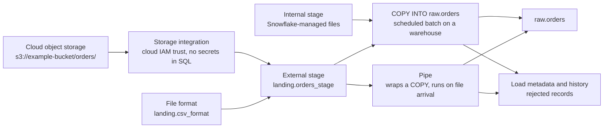
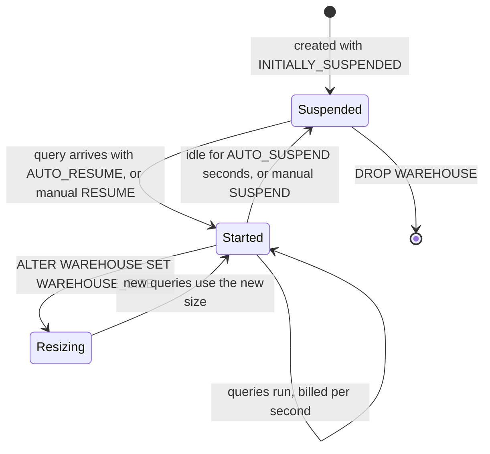
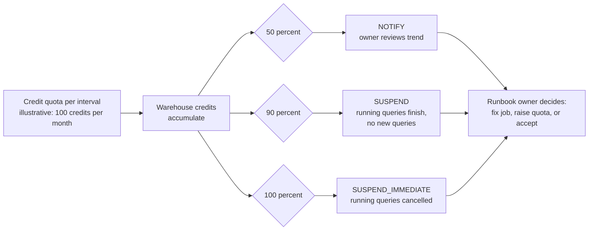

# Loading and Operations

Use fictional locations and names in examples. Real integrations require account-specific cloud IAM, network, and security review.

## File Format and Stage

```sql
CREATE FILE FORMAT landing.csv_format
  TYPE = CSV
  SKIP_HEADER = 1
  FIELD_OPTIONALLY_ENCLOSED_BY = '"';

CREATE STAGE landing.orders_stage
  URL = 's3://example-bucket/orders/'
  STORAGE_INTEGRATION = orders_storage_integration
  FILE_FORMAT = landing.csv_format;
```

An external stage points to external storage through an integration. An internal stage uses Snowflake-managed staging. Avoid embedding long-lived cloud secrets in scripts.

## Bulk Load

```sql
COPY INTO raw.orders
FROM @landing.orders_stage
PATTERN = '.*[.]csv'
ON_ERROR = 'ABORT_STATEMENT';
```

Choose error handling deliberately. Inspect load history and rejected records, and retain enough source data to replay safely. See [Data Loading Patterns](../deep-dives/03_data_loading_patterns.md).



Load metadata makes a rerun skip files already loaded, but a renamed or corrected file looks new. Business idempotency still needs stable record or batch keys downstream.

## Warehouse Basics

```sql
CREATE WAREHOUSE transform_wh
  WAREHOUSE_SIZE = 'XSMALL'
  AUTO_SUSPEND = 60
  AUTO_RESUME = TRUE
  INITIALLY_SUSPENDED = TRUE;
```

Warehouse sizes, scaling, billing, and service behavior can change. Start small, use auto-suspend, and measure. A larger warehouse is not a substitute for diagnosing the query.



Each resume bills a 60-second minimum, then per second. A very short auto-suspend with bursty queries can cost more than staying up a little longer, and every suspend also drops the warehouse's local data cache.

## Session Context and Diagnostics

```sql
SELECT
  CURRENT_ROLE(),
  CURRENT_WAREHOUSE(),
  CURRENT_DATABASE(),
  CURRENT_SCHEMA();
```

Use query history and Query Profile to distinguish queueing, scan volume, joins, spill, and execution time. Record query IDs when investigating an incident.

## Cost Guardrails

Use available resource monitors, budget controls, usage views, tags, and ownership conventions. A threshold without an owner and response procedure is not a complete cost-control system. Consult [Compute, Workloads, and Cost](../architecture/02_compute_workload_cost.md).



Thresholds are illustrative. Resource monitors cover warehouse credits only; serverless features need budgets or usage views, and a suspend action on a shared warehouse can stop production work along with the runaway job.

## Security Reminder

Do not commit passwords, tokens, private keys, account locators, or real data. Prefer managed identity and integrations supported by your account. Verify access under the role used by the actual workload, not only your administrator role.