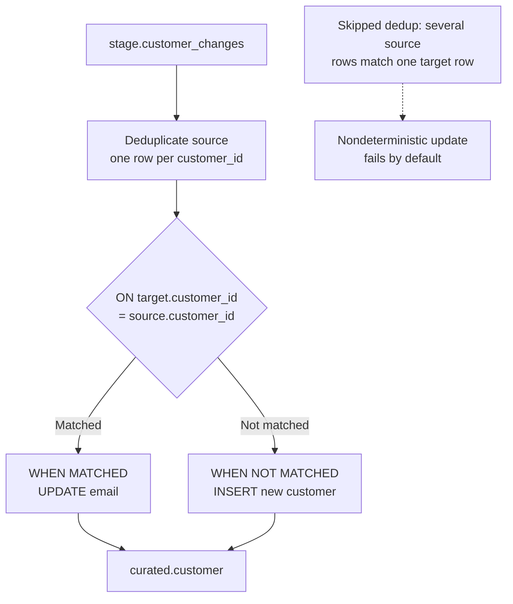
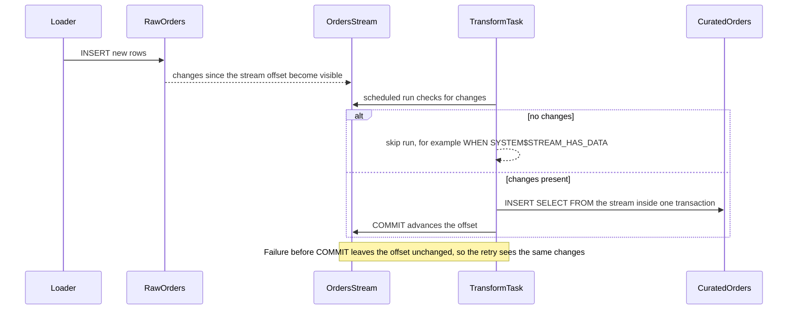
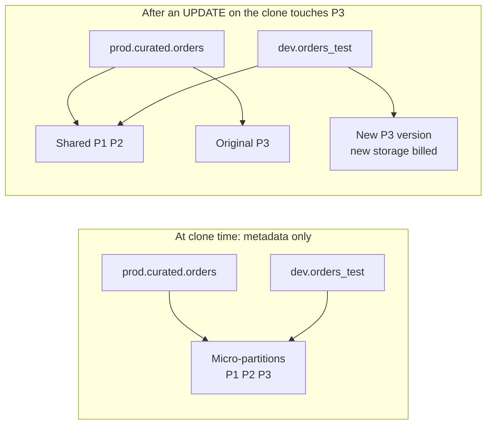
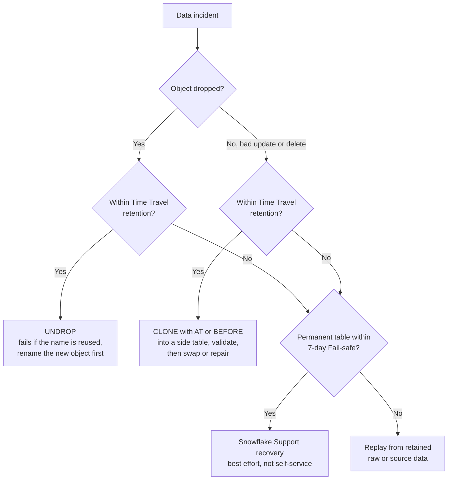

# Processing and Recovery

## `MERGE`

```sql
MERGE INTO curated.customer AS target
USING stage.customer_changes AS source
  ON target.customer_id = source.customer_id
WHEN MATCHED THEN UPDATE SET target.email = source.email
WHEN NOT MATCHED THEN INSERT (customer_id, email)
  VALUES (source.customer_id, source.email);
```

Deduplicate the source to one intended row per key before merging. Define delete, late-arriving update, and replay behavior explicitly.



Rerunning the same deduplicated source produces the same target state, which is what makes the `MERGE` safe to retry.

## Streams and Tasks

```sql
CREATE STREAM raw.orders_stream ON TABLE raw.orders;

CREATE TASK transform_orders
  WAREHOUSE = transform_wh
  SCHEDULE = '5 MINUTE'
AS
  INSERT INTO curated.orders
  SELECT * FROM raw.orders_stream;
```

A stream exposes change information for supported objects. A task schedules SQL or procedure execution. Validate task ownership, privileges, failure handling, and stream consumption behavior. A committed transaction that consumes a stream advances its offset; design the target write and stream consumption atomically where possible.



The failure path is the design point: if the target write and the offset advance are in different transactions, a retry can skip or duplicate rows.

## Dynamic Tables

Dynamic tables express a target query and freshness objective; Snowflake manages refresh behavior for supported queries. They differ from streams and tasks, where the developer wires explicit incremental steps. Inspect supported SQL, lag, refresh history, and cost for the actual workload.

## Time Travel

```sql
SELECT *
FROM curated.orders AT (OFFSET => -60 * 5);
```

This example queries a historical point. Retention, object eligibility, and syntax depend on current product behavior and configuration.

## Cloning and Undrop

```sql
CREATE TABLE dev.orders_test CLONE prod.curated.orders;
UNDROP TABLE prod.curated.orders;
```

A zero-copy clone shares micro-partitions with its source until either side changes data:



Storage grows only for partitions that diverge. Dropping the source does not free partitions a clone still references, and grants on a cloned table should be checked explicitly rather than assumed.

Use recovery commands only after confirming the target object and impact. Test recovery procedures in a disposable environment. Fail-safe is not a customer-operated backup or general-purpose historical query interface.



Restore into a side object and validate before touching production; the fastest command is not always the safest recovery. Source replay remains the fallback when retention windows have passed.

See [Incremental Processing](../deep-dives/04_incremental_processing.md) and [Availability and Recovery](../architecture/05_availability_and_recovery.md) for design guidance.