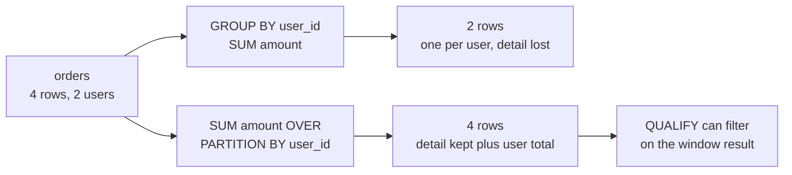
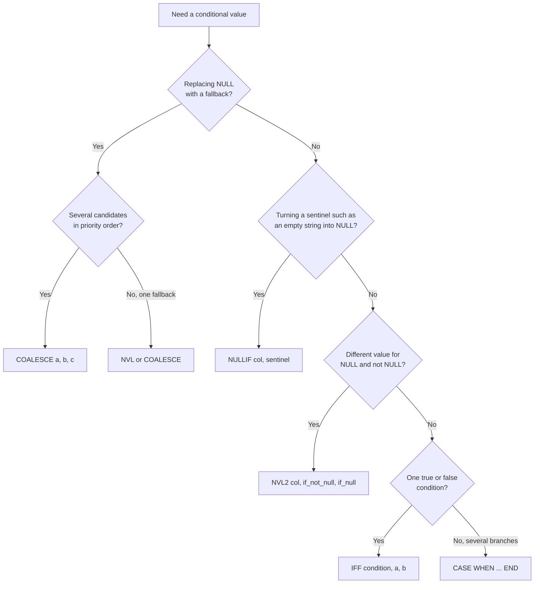
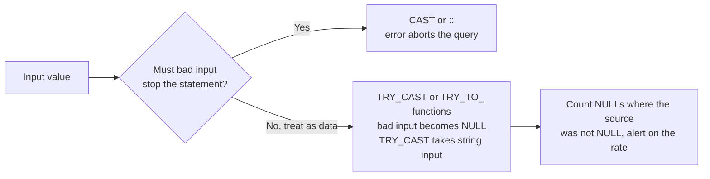

# Snowflake Functions — Complete Practical Cheat Sheet (Senior Level)

## 0. How to Use This File

For each function:
- what it does
- when to use
- example
- result

Focus:
- real usage
- interview-ready explanations

Function families covered in this file:

```mermaid
mindmap
  root((Snowflake functions))
    Aggregation
      COUNT SUM AVG ARRAY_AGG LISTAGG
    Window
      ROW_NUMBER RANK LAG LEAD plus QUALIFY
    Conditional and NULL
      CASE IFF COALESCE NULLIF NVL
    Date and time
      DATEADD DATEDIFF DATE_TRUNC
    String
      SPLIT_PART SUBSTR REGEXP
    Semi-structured
      PARSE_JSON FLATTEN TYPEOF
    Conversion
      CAST TRY_CAST
    User-defined
      Scalar UDF UDTF parameters defaults named arguments memoizable
    Row generators
      VALUES GENERATOR SPLIT_TO_TABLE
```



---

# User-Defined Functions (UDFs)

A UDF packages reusable logic behind a function name. The two common SQL forms differ in what they return:

- **Scalar UDF:** returns one value per call. When called with table columns, it produces a value for each input row.
- **Tabular UDF (UDTF):** returns a table of zero, one, or many rows and is called in the `FROM` clause.

Use the form that matches the result shape. Prefer built-in SQL functions for simple transformations rather than wrapping them in a custom function.

## Scalar SQL UDF: Parameters and Return Type

The function signature declares each parameter's **name** and **SQL data type**. The `RETURNS` clause declares the result type. Inside the SQL body, parameter names refer to the values supplied by the caller.

```sql
CREATE OR REPLACE FUNCTION analytics.price_after_discount(
    gross_amount NUMBER(12, 2),
    discount_rate NUMBER(5, 4) DEFAULT 0
)
RETURNS NUMBER(12, 2)
LANGUAGE SQL
AS
$$
    SELECT ROUND(gross_amount * (1 - discount_rate), 2)
$$;
```

In this example:

- `gross_amount` is required. The caller must pass it.
- `discount_rate` is optional because it has a `DEFAULT` value of `0`.
- Both parameters have explicit SQL types, which form part of the function's contract.
- `RETURNS NUMBER(12, 2)` describes the output type; it is separate from the input parameter types.
- The body uses the parameter names to calculate the result.

Optional parameters must come after required parameters. A default is used only when the argument is **omitted**; passing `NULL` explicitly is different and makes this expression return `NULL`.

## Calling a UDF: Positional and Named Arguments

Arguments can be passed by position:

```sql
SELECT analytics.price_after_discount(100, 0.15);
-- 85.00
```

With positional arguments, the order must match the function signature: `gross_amount` first, then `discount_rate`.

Arguments can also be passed by name with `=>`. Named arguments make calls clearer and allow an optional argument to be specified while an earlier optional argument is omitted:

```sql
SELECT analytics.price_after_discount(
    gross_amount => 100,
    discount_rate => 0.15
);
-- 85.00

SELECT analytics.price_after_discount(gross_amount => 100);
-- 100.00; discount_rate uses its default of 0
```

You may mix positional and named arguments, but put all positional arguments first:

```sql
SELECT analytics.price_after_discount(100, discount_rate => 0.15);
-- 85.00
```

## Explicit `NULL` Is Not the Default

The default value applies when an optional argument is left out. It does not replace an explicitly supplied `NULL`:

```sql
SELECT analytics.price_after_discount(100);
-- 100.00

SELECT analytics.price_after_discount(100, NULL);
-- NULL; the expression propagates NULL
```

If the business rule says that a `NULL` discount should mean “no discount,” encode that behavior in the function body:

```sql
CREATE OR REPLACE FUNCTION analytics.price_after_discount_null_as_zero(
    gross_amount NUMBER(12, 2),
    discount_rate NUMBER(5, 4) DEFAULT 0
)
RETURNS NUMBER(12, 2)
LANGUAGE SQL
AS
$$
    SELECT ROUND(gross_amount * (1 - COALESCE(discount_rate, 0)), 2)
$$;
```

Do not silently treat `NULL` as zero unless that matches the domain rule; `NULL` can represent missing or unknown input.

## Apply a UDF to Table Columns

A UDF can be called with literals, expressions, or columns:

```sql
SELECT
    order_id,
    gross_amount,
    discount_rate,
    analytics.price_after_discount(gross_amount, discount_rate) AS net_amount
FROM sales.orders;
```

The arguments for each row are evaluated using that row's column values. The function does not change or store the source columns; this query returns a calculated output column.

## Tabular SQL UDF (UDTF): Return Multiple Rows

Use a UDTF when one input can produce a set of rows. This example turns a delimited string into rows and returns each token with its zero-based position:

```sql
CREATE OR REPLACE FUNCTION analytics.split_labels(
    input_text VARCHAR,
    delimiter VARCHAR
)
RETURNS TABLE (
    position NUMBER,
    label VARCHAR
)
LANGUAGE SQL
AS
$$
    SELECT f.index::NUMBER, f.value::VARCHAR
    FROM TABLE(FLATTEN(INPUT => SPLIT(input_text, delimiter))) AS f
$$;
```

Call the UDTF in the `FROM` clause:

```sql
SELECT position, label
FROM TABLE(analytics.split_labels('gold,silver,gold', ','))
ORDER BY position;
```

Result:

| POSITION | LABEL |
| ---: | --- |
| 0 | gold |
| 1 | silver |
| 2 | gold |

A table function can also be correlated with each row of an input table using `LATERAL`:

```sql
SELECT o.order_id, labels.position, labels.label
FROM sales.orders AS o,
     LATERAL TABLE(analytics.split_labels(o.labels, ',')) AS labels;
```

Here, one order row can produce several result rows. If splitting text is the only requirement, prefer Snowflake's built-in `SPLIT_TO_TABLE` rather than maintaining a UDTF that wraps the same built-in behavior. The custom example demonstrates the UDTF shape and invocation syntax.

## Performance: Choose the Right Execution Shape

There is no general `FAST` switch that makes every UDF faster. Function type, body, input row count, and output row count determine whether a UDF is a good fit.

### Memoizable scalar SQL UDFs

`MEMOIZABLE` lets Snowflake cache results for eligible **scalar SQL UDFs** and reuse them when appropriate. This can help with repeated lookups against a small mapping table, especially in row access or masking policies. It is not a general-purpose cache for arbitrary functions.

For example, assume `ANALYTICS.REFERENCE.SEGMENT_DISCOUNT` has one row per segment:

```sql
CREATE OR REPLACE FUNCTION analytics.discount_rate_for_segment(
    input_segment VARCHAR
)
RETURNS NUMBER(5, 4)
MEMOIZABLE
LANGUAGE SQL
AS
$$
    SELECT discount_rate
    FROM analytics.reference.segment_discount
    WHERE segment = input_segment
$$;
```

The function can then be called for a constant segment value:

```sql
SELECT analytics.discount_rate_for_segment('LOYALTY');
```

The lookup table must return at most one row for each segment. This example passes a constant argument; a table-column argument such as `o.segment` is not supported for a memoizable function.

Important limitations and cautions:

- Memoizable functions are scalar SQL UDFs, not UDTFs or Python/JavaScript UDFs.
- Arguments must be constant values of supported scalar types; a table column such as `o.segment` is not a valid memoizable-function argument.
- Cache use is conditional, not guaranteed. Changes to referenced objects or access control, or nondeterministic/external function dependencies, can prevent reuse.
- Snowflake documents a 10 KB result-cache limit per memoizable function for the current session. Larger results are not cached.
- Use this for repeated, relatively small lookup results; do not mark a simple arithmetic UDF memoizable expecting a performance gain.

### Practical performance choices

1. **Prefer native SQL first.** Built-in functions and relational expressions are usually the simplest way for Snowflake to optimize common transformations.
2. **Use scalar UDFs for scalar logic.** A scalar UDF is a natural fit when each input row needs one reusable result. Keep its body focused and avoid unnecessary lookups or complex work per row.
3. **Use UDTFs when row expansion is required.** A UDTF can increase row count substantially. Filter the input rows before the lateral call when possible, and return only the columns consumers need.
4. **Do not move work into a UDF just to hide a query.** A function boundary does not guarantee better performance or make inefficient logic efficient.
5. **Measure representative workloads.** Compare equivalent results on realistic volumes, inspect Query Profile for expensive operators and row expansion, and avoid drawing conclusions from a single cached run.

If Python or JavaScript is needed for logic that SQL cannot express conveniently, test its runtime overhead against a SQL implementation and the workload's actual row volume. Use a language-specific vectorized/batch option only when its input shape and implementation fit; it is not a generic switch for SQL UDFs.

## Parameter Design Checklist

- Give parameters names that communicate their meaning and units, such as `discount_rate` rather than `value`.
- Declare SQL types that match the expected domain, including precision and scale for numeric values where useful.
- Put required arguments first and optional arguments with `DEFAULT` values last.
- Use named arguments for calls that have several parameters or omit an optional argument before specifying a later one.
- Decide explicitly how `NULL` should behave; a default only applies to an omitted argument.
- Keep the return type aligned with the expression and expected downstream contract.

For official syntax and language-specific argument behavior, see [Defining arguments for UDFs and stored procedures](https://docs.snowflake.com/en/developer-guide/udf-stored-procedure-arguments), [Executing a UDF](https://docs.snowflake.com/en/developer-guide/udf/udf-calling-sql), [Scalar SQL UDFs and memoizable UDFs](https://docs.snowflake.com/en/developer-guide/udf/sql/udf-sql-scalar-functions), and [Tabular SQL UDFs (UDTFs)](https://docs.snowflake.com/en/developer-guide/udf/sql/udf-sql-tabular-functions).

---

# 1. Aggregation Functions

## COUNT

Counts rows.

    SELECT COUNT(*) FROM t;

Result:
total number of rows

## COUNT(DISTINCT)

Counts unique values.

    SELECT COUNT(DISTINCT user_id) FROM t;

Result:
number of unique users

⚠️ Interview:
> Use only when business requires uniqueness, not to hide bad joins.

---

## SUM

    SELECT SUM(amount) FROM t;

Result:
total sum of amount

---

## AVG

    SELECT AVG(amount) FROM t;

Result:
average value

⚠️ Trap:
averaging averages is often wrong

---

## MIN / MAX

    SELECT MIN(ts), MAX(ts) FROM t;

Result:
earliest and latest timestamp

---

## ARRAY_AGG

Collects values into array.

    SELECT ARRAY_AGG(user_id) FROM t;

Result:
[1,2,3,...]

---

## OBJECT_AGG

    SELECT OBJECT_AGG(key, value) FROM t;

Result:
{ "a":1, "b":2 }

---

## LISTAGG

String aggregation.

    SELECT LISTAGG(name, ',') FROM t;

Result:
"a,b,c"

---

# 2. Window Functions

Aggregate vs window, on the same input:



## ROW_NUMBER

    SELECT
        user_id,
        ROW_NUMBER() OVER (
            PARTITION BY user_id
            ORDER BY ts DESC
        ) AS rn
    FROM t;

Result:
ranking per user

Use:
dedup, latest row

---

## RANK / DENSE_RANK

Difference:
- RANK → gaps
- DENSE_RANK → no gaps

---

## LAG

    SELECT
        ts,
        LAG(ts) OVER (ORDER BY ts) AS prev_ts
    FROM t;

Result:
previous row value

---

## LEAD

same but forward

---

## FIRST_VALUE / LAST_VALUE

⚠️ Trap: frame matters

    LAST_VALUE(x) OVER (
        ORDER BY ts
        ROWS BETWEEN UNBOUNDED PRECEDING AND UNBOUNDED FOLLOWING
    )

---

## SUM() OVER

Running total

    SUM(amount) OVER (
        PARTITION BY user_id
        ORDER BY ts
    )

---

# 3. QUALIFY (Snowflake-specific)

Filters window results.

    SELECT *
    FROM t
    QUALIFY ROW_NUMBER() OVER (
        PARTITION BY user_id
        ORDER BY ts DESC
    ) = 1;

Result:
latest row per user

---

# 4. Conditional & Null Handling

Picking the right helper:



## CASE

    CASE WHEN amount > 100 THEN 'high' ELSE 'low' END

---

## IFF

Short CASE

    IFF(amount > 100, 'high', 'low')

---

## COALESCE

    COALESCE(col, 'default')

Result:
first non-null

---

## NULLIF

    NULLIF(a, b)

Result:
NULL if equal

---

## NVL / NVL2

Oracle-style null handling

---

# 5. Date & Time

## CURRENT_DATE

    SELECT CURRENT_DATE;

---

## DATEADD

    DATEADD(day, 7, current_date)

Result:
+7 days

---

## DATEDIFF

    DATEDIFF(day, '2024-01-01', '2024-01-10')

Result:
9

---

## DATE_TRUNC

    DATE_TRUNC('month', ts)

Result:
first day of month

---

## EXTRACT

    EXTRACT(year FROM ts)

---

# 6. String Functions

## SPLIT_PART

    SPLIT_PART('a,b,c', ',', 2)

Result:
b

---

## SUBSTR

    SUBSTR('abcdef', 1, 3)

Result:
abc

---

## CONCAT / ||

    'a' || 'b'

Result:
ab

---

## REGEXP_SUBSTR

Extract using regex

---

## REGEXP_REPLACE

Replace pattern

---

# 7. Semi-Structured

## PARSE_JSON

    SELECT PARSE_JSON('{"a":1}');

---

## FLATTEN

    SELECT f.value
    FROM TABLE(FLATTEN(input => parse_json('[1,2,3]'))) f;

Result:
1
2
3

---

## ARRAY_CONSTRUCT

    SELECT ARRAY_CONSTRUCT(1,2,3);

---

## OBJECT_CONSTRUCT

    SELECT OBJECT_CONSTRUCT('a',1);

---

## TYPEOF

    SELECT TYPEOF(parse_json('{"a":1}'));

---

# 8. Casting / Conversion

## CAST

    CAST('123' AS NUMBER)

---

## ::

    '123'::NUMBER

---

## TRY_CAST

Returns NULL instead of error



The trade-off: a hard cast stops the pipeline loudly; a `TRY_` cast keeps it running but hides bad data unless the failure rate is measured.

---

# 9. Table Creation from Text / Values

## VALUES

    SELECT *
    FROM VALUES (1,'a'), (2,'b') AS t(id, val);

Result:

id | val  
1  | a  
2  | b  

---

## UNION ALL

    SELECT 1 AS id
    UNION ALL
    SELECT 2;

---

## CTE

    WITH t AS (
        SELECT 1 AS id
    )
    SELECT * FROM t;

---

## GENERATOR

    SELECT seq4()
    FROM TABLE(GENERATOR(rowcount => 5));

Result:
0,1,2,3,4

---

## SPLIT_TO_TABLE

    SELECT value
    FROM TABLE(SPLIT_TO_TABLE('a,b,c', ','));

Result:
a
b
c

---

## JSON → TABLE

    SELECT f.value
    FROM TABLE(FLATTEN(
        input => PARSE_JSON('[1,2,3]')
    )) f;

---

## ARRAY → TABLE

    SELECT f.value
    FROM TABLE(FLATTEN(
        input => ARRAY_CONSTRUCT(1,2,3)
    )) f;

---

## OBJECT → TABLE

    SELECT f.key, f.value
    FROM TABLE(FLATTEN(
        input => OBJECT_CONSTRUCT('a',1,'b',2)
    )) f;

Result:
a 1  
b 2  

---

# 10. Advanced Snowflake Helpers

## HASH

    SELECT HASH(user_id);

---

## RANDOM

    SELECT RANDOM();

---

## GREATEST / LEAST

    SELECT GREATEST(1,5,3);

Result:
5

---

## WIDTH_BUCKET

Histogram bucket

---

# 11. Real Interview Snippets

## Latest row per user

    SELECT *
    FROM t
    QUALIFY ROW_NUMBER() OVER (
        PARTITION BY user_id
        ORDER BY ts DESC
    ) = 1;

---

## Top 3 per group

    QUALIFY ROW_NUMBER() OVER (
        PARTITION BY category
        ORDER BY sales DESC
    ) <= 3;

---

## Anti-join

    WHERE NOT EXISTS (
        SELECT 1
        FROM orders o
        WHERE o.user_id = u.user_id
    )

---

## Sessionization

- LAG
- gap detection
- cumulative SUM

---

# 12. Senior-Level Summary

- window functions = core
- QUALIFY = must-use
- FLATTEN = powerful but dangerous
- VALUES / GENERATOR = fast prototyping
- casting matters
- always define grain before aggregation

---

# 13. Final One-Line Summary

Strong Snowflake SQL is not about knowing functions — it's about knowing when and why to use them correctly.