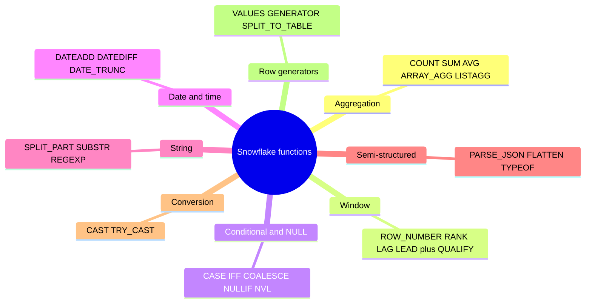
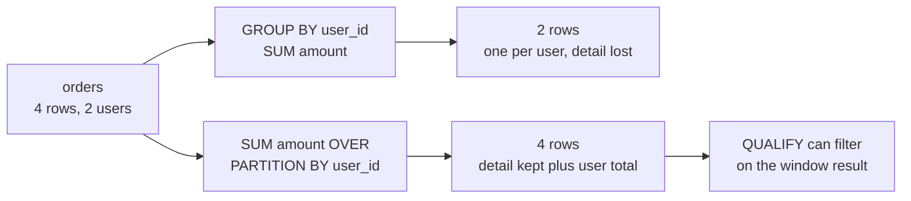
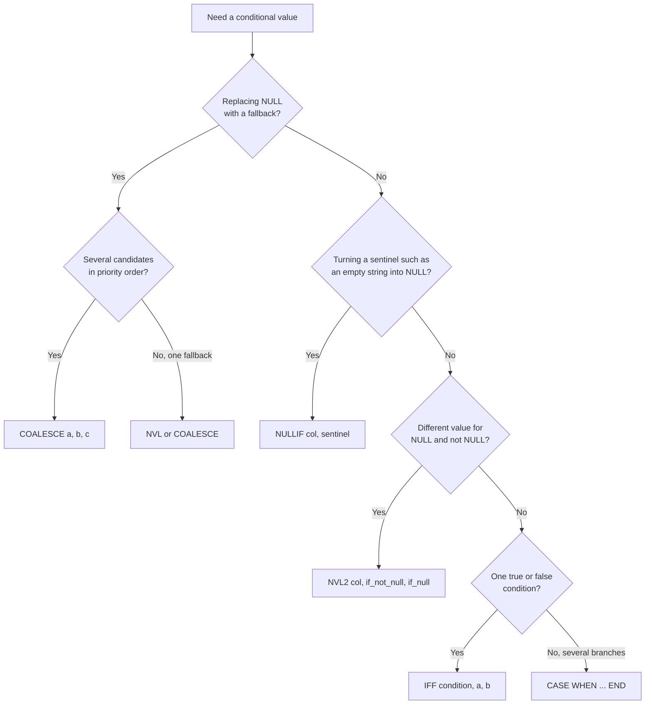
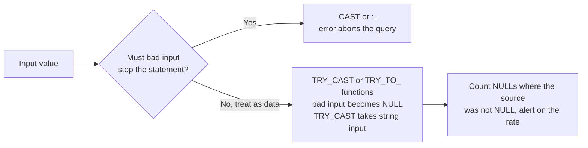

# Snowflake Functions — Complete Practical Cheat Sheet (Senior Level)

## 0. How to Use This File

For each function:
- what it does
- when to use
- example
- result

Focus:
- real usage
- interview-ready explanations

Function families covered in this file:

---

# 1. Aggregation Functions

## COUNT

Counts rows.

    SELECT COUNT(*) FROM t;

Result:
total number of rows

## COUNT(DISTINCT)

Counts unique values.

    SELECT COUNT(DISTINCT user_id) FROM t;

Result:
number of unique users

⚠️ Interview:
> Use only when business requires uniqueness, not to hide bad joins.

---

## SUM

    SELECT SUM(amount) FROM t;

Result:
total sum of amount

---

## AVG

    SELECT AVG(amount) FROM t;

Result:
average value

⚠️ Trap:
averaging averages is often wrong

---

## MIN / MAX

    SELECT MIN(ts), MAX(ts) FROM t;

Result:
earliest and latest timestamp

---

## ARRAY_AGG

Collects values into array.

    SELECT ARRAY_AGG(user_id) FROM t;

Result:
[1,2,3,...]

---

## OBJECT_AGG

    SELECT OBJECT_AGG(key, value) FROM t;

Result:
{ "a":1, "b":2 }

---

## LISTAGG

String aggregation.

    SELECT LISTAGG(name, ',') FROM t;

Result:
"a,b,c"

---

# 2. Window Functions

Aggregate vs window, on the same input:

## ROW_NUMBER

    SELECT
        user_id,
        ROW_NUMBER() OVER (
            PARTITION BY user_id
            ORDER BY ts DESC
        ) AS rn
    FROM t;

Result:
ranking per user

Use:
dedup, latest row

---

## RANK / DENSE_RANK

Difference:
- RANK → gaps
- DENSE_RANK → no gaps

---

## LAG

    SELECT
        ts,
        LAG(ts) OVER (ORDER BY ts) AS prev_ts
    FROM t;

Result:
previous row value

---

## LEAD

same but forward

---

## FIRST_VALUE / LAST_VALUE

⚠️ Trap: frame matters

    LAST_VALUE(x) OVER (
        ORDER BY ts
        ROWS BETWEEN UNBOUNDED PRECEDING AND UNBOUNDED FOLLOWING
    )

---

## SUM() OVER

Running total

    SUM(amount) OVER (
        PARTITION BY user_id
        ORDER BY ts
    )

---

# 3. QUALIFY (Snowflake-specific)

Filters window results.

    SELECT *
    FROM t
    QUALIFY ROW_NUMBER() OVER (
        PARTITION BY user_id
        ORDER BY ts DESC
    ) = 1;

Result:
latest row per user

---

# 4. Conditional & Null Handling

Picking the right helper:

## CASE

    CASE WHEN amount > 100 THEN 'high' ELSE 'low' END

---

## IFF

Short CASE

    IFF(amount > 100, 'high', 'low')

---

## COALESCE

    COALESCE(col, 'default')

Result:
first non-null

---

## NULLIF

    NULLIF(a, b)

Result:
NULL if equal

---

## NVL / NVL2

Oracle-style null handling

---

# 5. Date & Time

## CURRENT_DATE

    SELECT CURRENT_DATE;

---

## DATEADD

    DATEADD(day, 7, current_date)

Result:
+7 days

---

## DATEDIFF

    DATEDIFF(day, '2024-01-01', '2024-01-10')

Result:
9

---

## DATE_TRUNC

    DATE_TRUNC('month', ts)

Result:
first day of month

---

## EXTRACT

    EXTRACT(year FROM ts)

---

# 6. String Functions

## SPLIT_PART

    SPLIT_PART('a,b,c', ',', 2)

Result:
b

---

## SUBSTR

    SUBSTR('abcdef', 1, 3)

Result:
abc

---

## CONCAT / ||

    'a' || 'b'

Result:
ab

---

## REGEXP_SUBSTR

Extract using regex

---

## REGEXP_REPLACE

Replace pattern

---

# 7. Semi-Structured

## PARSE_JSON

    SELECT PARSE_JSON('{"a":1}');

---

## FLATTEN

    SELECT f.value
    FROM TABLE(FLATTEN(input => parse_json('[1,2,3]'))) f;

Result:
1
2
3

---

## ARRAY_CONSTRUCT

    SELECT ARRAY_CONSTRUCT(1,2,3);

---

## OBJECT_CONSTRUCT

    SELECT OBJECT_CONSTRUCT('a',1);

---

## TYPEOF

    SELECT TYPEOF(parse_json('{"a":1}'));

---

# 8. Casting / Conversion

## CAST

    CAST('123' AS NUMBER)

---

## ::

    '123'::NUMBER

---

## TRY_CAST

Returns NULL instead of error

The trade-off: a hard cast stops the pipeline loudly; a `TRY_` cast keeps it running but hides bad data unless the failure rate is measured.

---

# 9. Table Creation from Text / Values

## VALUES

    SELECT *
    FROM VALUES (1,'a'), (2,'b') AS t(id, val);

Result:

id | val  
1  | a  
2  | b  

---

## UNION ALL

    SELECT 1 AS id
    UNION ALL
    SELECT 2;

---

## CTE

    WITH t AS (
        SELECT 1 AS id
    )
    SELECT * FROM t;

---

## GENERATOR

    SELECT seq4()
    FROM TABLE(GENERATOR(rowcount => 5));

Result:
0,1,2,3,4

---

## SPLIT_TO_TABLE

    SELECT value
    FROM TABLE(SPLIT_TO_TABLE('a,b,c', ','));

Result:
a
b
c

---

## JSON → TABLE

    SELECT f.value
    FROM TABLE(FLATTEN(
        input => PARSE_JSON('[1,2,3]')
    )) f;

---

## ARRAY → TABLE

    SELECT f.value
    FROM TABLE(FLATTEN(
        input => ARRAY_CONSTRUCT(1,2,3)
    )) f;

---

## OBJECT → TABLE

    SELECT f.key, f.value
    FROM TABLE(FLATTEN(
        input => OBJECT_CONSTRUCT('a',1,'b',2)
    )) f;

Result:
a 1  
b 2  

---

# 10. Advanced Snowflake Helpers

## HASH

    SELECT HASH(user_id);

---

## RANDOM

    SELECT RANDOM();

---

## GREATEST / LEAST

    SELECT GREATEST(1,5,3);

Result:
5

---

## WIDTH_BUCKET

Histogram bucket

---

# 11. Real Interview Snippets

## Latest row per user

    SELECT *
    FROM t
    QUALIFY ROW_NUMBER() OVER (
        PARTITION BY user_id
        ORDER BY ts DESC
    ) = 1;

---

## Top 3 per group

    QUALIFY ROW_NUMBER() OVER (
        PARTITION BY category
        ORDER BY sales DESC
    ) <= 3;

---

## Anti-join

    WHERE NOT EXISTS (
        SELECT 1
        FROM orders o
        WHERE o.user_id = u.user_id
    )

---

## Sessionization

- LAG
- gap detection
- cumulative SUM

---

# 12. Senior-Level Summary

- window functions = core
- QUALIFY = must-use
- FLATTEN = powerful but dangerous
- VALUES / GENERATOR = fast prototyping
- casting matters
- always define grain before aggregation

---

# 13. Final One-Line Summary

Strong Snowflake SQL is not about knowing functions — it's about knowing when and why to use them correctly.