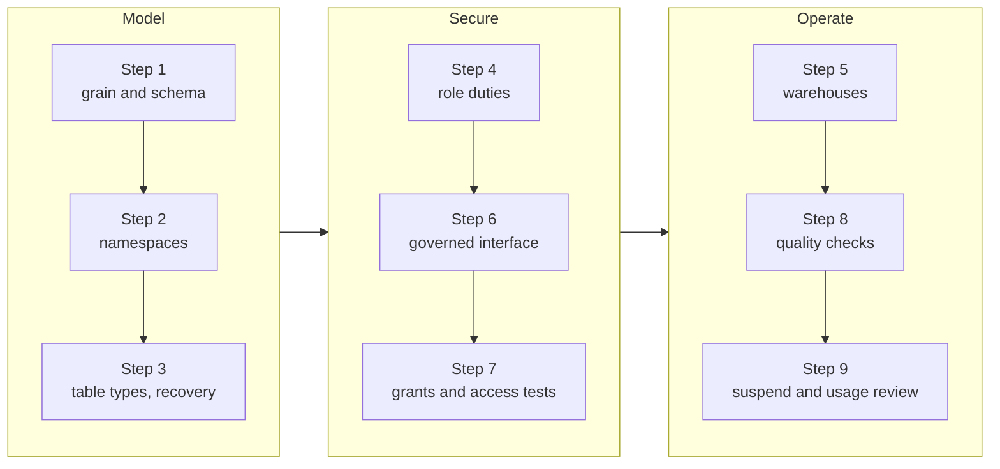

# Project 01: Governed Analytics Warehouse

## Goal

Design and optionally implement a small Snowflake warehouse for fictional orders. Practice the platform basics: namespaces, tables, roles, warehouses, typed data, and a governed consumer interface.

## Scenario

An online retailer receives daily order data. Analysts need daily revenue and active-customer reporting. The raw source contains customer email and internal operational fields that must not be exposed in the analyst interface.

## Work

1. Define the data grain and a minimal order/customer schema.
2. Create a namespace layout for raw, curated, and reporting data.
3. Choose table types and state retention/recovery assumptions.
4. Define separate loader, transformer, and analyst responsibilities.
5. Propose a small ingestion/transform warehouse and a BI warehouse; explain whether both are needed initially.
6. Design a secure consumer view or an alternative policy/table boundary.
7. State how new objects receive grants and how a test role verifies access.
8. Add basic quality checks for duplicate order IDs, null keys, and invalid amounts.
9. Define an auto-suspend and usage-review approach.

Project milestones:

## Deliverables

- `architecture.md` completed with your choices and alternatives
- an object and role diagram
- SQL DDL and sample transformation SQL if an account is available
- a short test checklist proving both allowed and denied access
- a one-paragraph cost and recovery note

## Acceptance Criteria

- Every object has a purpose and owner.
- Analyst access does not rely on an administrator role.
- Sensitive fields are not exposed through the intended reporting interface.
- The design handles duplicate and invalid input visibly.
- The warehouse and table lifecycle choices include an explicit trade-off.

## Cost and Safety

Execution is optional. If using an account, use small resources, auto-suspend, fictional data, and a disposable schema. Remove lab resources when finished. Do not test grants with production identities or data.