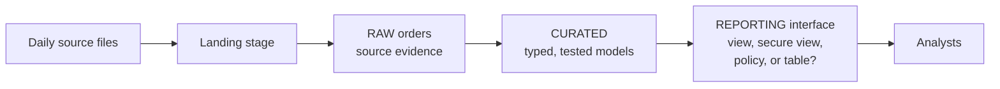
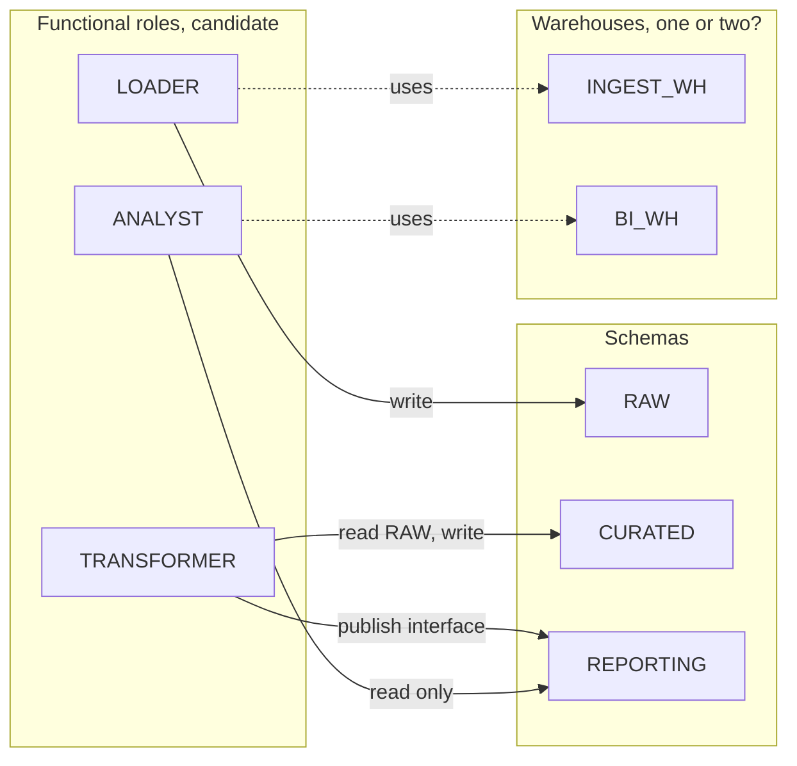
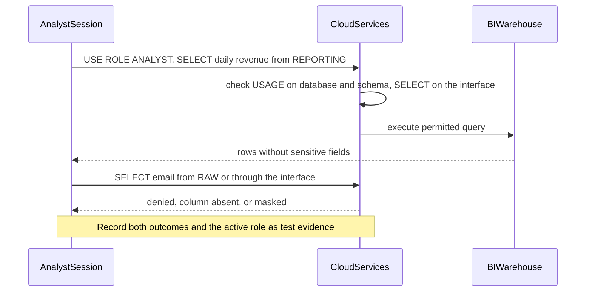

# Architecture Brief: Governed Analytics Warehouse

## Candidate Flow

```text
Daily source files -> landing -> raw orders -> typed curated models
                                      -> governed reporting view -> analysts
```

Figure of the candidate flow above (explanatory, not your answer; the open choice is marked with a question):



## Candidate Boundaries

- `RAW` preserves source evidence with restricted loader and platform access.
- `CURATED` contains typed, tested tables owned by the data team.
- `REPORTING` exposes stable consumer interfaces with only required attributes.
- `INGEST_WH` and `BI_WH` can isolate workload classes; a single small warehouse may be simpler for an initial low-volume lab.
- Loader and transformer roles are separate from analyst roles.

These are candidates rather than requirements. A smaller organization may start with fewer schemas or one warehouse, provided ownership and access remain clear.

Example skeleton to adapt: the candidate boundaries as a role-to-object picture. Replace, merge, or remove boxes to match your own decisions.



Nothing connects `ANALYST` to `RAW` or `CURATED`; your grants and tests should prove that absence, not only the permitted path.

## Decisions to Record

1. Which source fields are retained, typed, or excluded?
2. Is an analyst interface best implemented as a view, secure view, policy, or curated table?
3. Which role owns objects and future grants?
4. What is the acceptable reporting freshness?
5. What table recovery behavior is required?
6. What usage threshold or review catches unexpected compute?

## Review

Test a permitted analyst query and an explicitly denied sensitive-field query. Check the active role, namespace privileges, object grant, and policy behavior. Estimate the operational burden of separate warehouses against the actual workload.

Example shape of the two access tests (adapt names and expected outcomes to your design):

