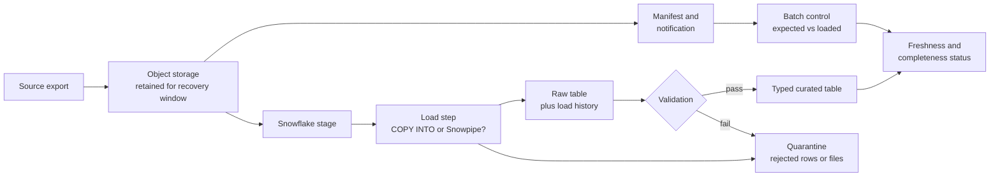
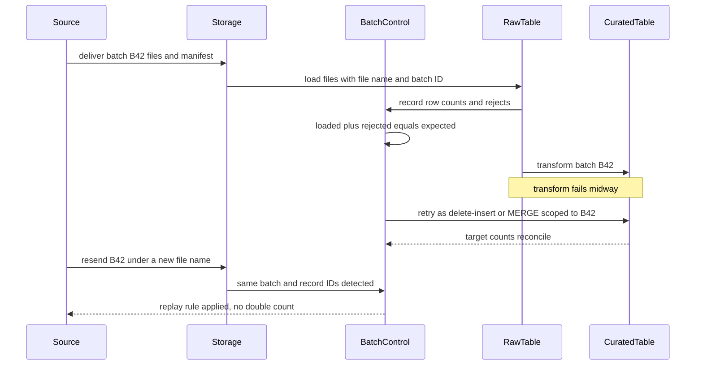

# Architecture Brief: Reliable File Ingestion

## Candidate Flow

```text
Source export -> object storage -> manifest and notification
             -> Snowflake stage -> raw load history -> validation/quarantine
             -> typed curated table -> freshness/completeness status
```

Figure of the candidate flow (explanatory; the ingestion pattern is still your decision):



## Reliability Contract

For every batch, record source, batch ID, file identity, schema version, expected count, arrival time, load result, rejected rows, target batch, and replay attempts. Preserve source files for a defined recovery window. Make the curated transformation deterministic for a given input batch.

## Pattern Selection

Scheduled `COPY INTO` is a reasonable starting point when daily files and a daily freshness target are acceptable. Snowpipe may fit supported continuous file arrivals. Lower-latency row delivery may require Snowpipe Streaming or a broader event-ingestion platform. The final choice depends on measured volume, delivery guarantees, ordering, replay, and regional availability.

## Failure Cases

| Failure | Expected response |
| --- | --- |
| Missing file | Mark delivery incomplete and alert source owner |
| Malformed file | Quarantine or fail visibly; retain evidence |
| Duplicate delivery | Detect by stable delivery/source identifiers and apply replay rule |
| Corrected file | Version the delivery and document replacement semantics |
| Partial transform | Retry deterministically and reconcile target counts |

Example replay path to adapt (batch ID is illustrative). It shows two rows of the table above: a partial transform retry and a resent delivery.



The retry is safe because it is scoped by batch identity, not by "whatever is new in the stage".

## Review

Confirm who owns source completeness, cloud permissions, load monitoring, quarantine resolution, and consumer communication. Measure end-to-end freshness rather than only load-command duration.