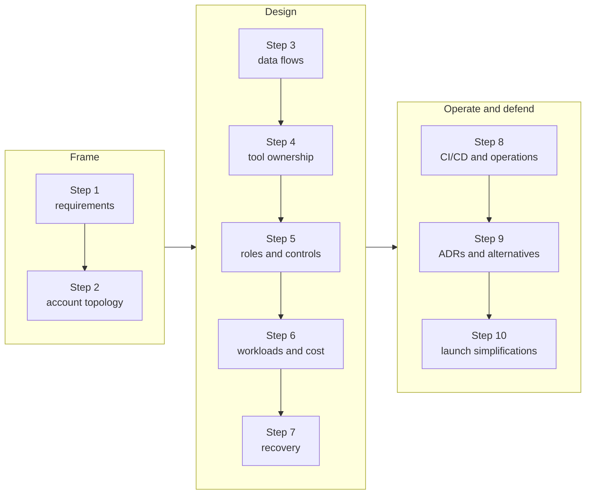

# Project 03: Production Snowflake Platform

## Goal

Produce and defend a platform architecture for multiple environments and data domains. This is a design capstone; an account is not required.

## Scenario

A growing organization has development and production workloads, two data domains, batch and near-real-time sources, BI consumers, regulated fields, a small platform team, and a stated recovery objective. You must propose a Snowflake-centered platform that can evolve without overbuilding.

## Work

1. Write explicit functional and non-functional requirements, including freshness, availability, recovery, residency, and cost.
2. Compare account topologies and select environment/domain boundaries.
3. Draw source, ingestion, raw, transformation, curated, and serving flows.
4. Assign ownership for Snowflake, dbt, Airflow, Kafka, and external cloud services.
5. Design role hierarchy, sensitive-data controls, and consumer interfaces.
6. Allocate workloads to warehouses or serverless capabilities with cost attribution.
7. Select recovery mechanisms and define RPO/RTO validation.
8. Define CI/CD, schema promotion, tests, secrets, monitoring, and incident ownership.
9. Compare at least two alternatives and record decisions as short ADRs.
10. Identify the first two simplifications you would make for an initial launch.

Project milestones:

## Deliverables

- completed `architecture.md`
- a platform diagram
- account/object/role boundary table
- decision log with trade-offs
- failure-mode and recovery table
- phased implementation plan and operating checklist

## Acceptance Criteria

- Requirements lead to the design; features are not included without a reason.
- Snowflake and surrounding tools have clear responsibility boundaries.
- Security, cost, freshness, and recovery are addressed together.
- The proposal distinguishes current needs from future extensions.
- Trade-offs and assumptions are explicit enough for a design review.

## Evaluation Rubric

Use this to self-review or to review a peer's design. Each level includes the one before it.

| Dimension | Meets | Strong | Architect-level |
| --- | --- | --- | --- |
| Requirements | Functional and non-functional requirements are listed | Freshness, RPO/RTO, residency, and cost targets are measurable | Requirements are ranked, conflicts between them are resolved explicitly, and each major design choice traces back to one |
| Boundaries | Dev and prod are separated and domains are named | Account/database/schema boundaries are justified against blast radius and deployment burden | At least two topologies are compared, with the signal that would justify changing topology later |
| Security | Functional and service roles exist; analysts do not use admin roles | Least privilege, future grants, policy ownership, and denied-path tests are defined | Sensitive-data controls are consistent across every access path, including sharing, clones, and external integrations, with audit evidence |
| Cost | Warehouses have auto-suspend and an owner | Workloads are classified, attribution and budget alerts are defined | Cost is modelled per workload and freshness choice, with a review cadence and a redesign trigger |
| Recovery | Time Travel and replication are mentioned | Mechanisms are mapped to failure types with retention limits and RPO/RTO | Recovery includes identity, integrations, cutover, validation, failback, and a timed drill plan |
| Operations | Monitoring and alerts are listed | Alert owners, runbooks, CI validation, and promotion steps are defined | One owner per retry, schedule, and incident state; the design is operable by the current team size |
| Trade-offs | Alternatives are named | Each major decision has an ADR with benefits and costs | ADRs state assumptions, evidence still needed, failure modes, and what is deliberately not built in release one |