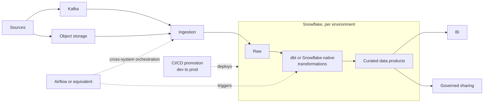
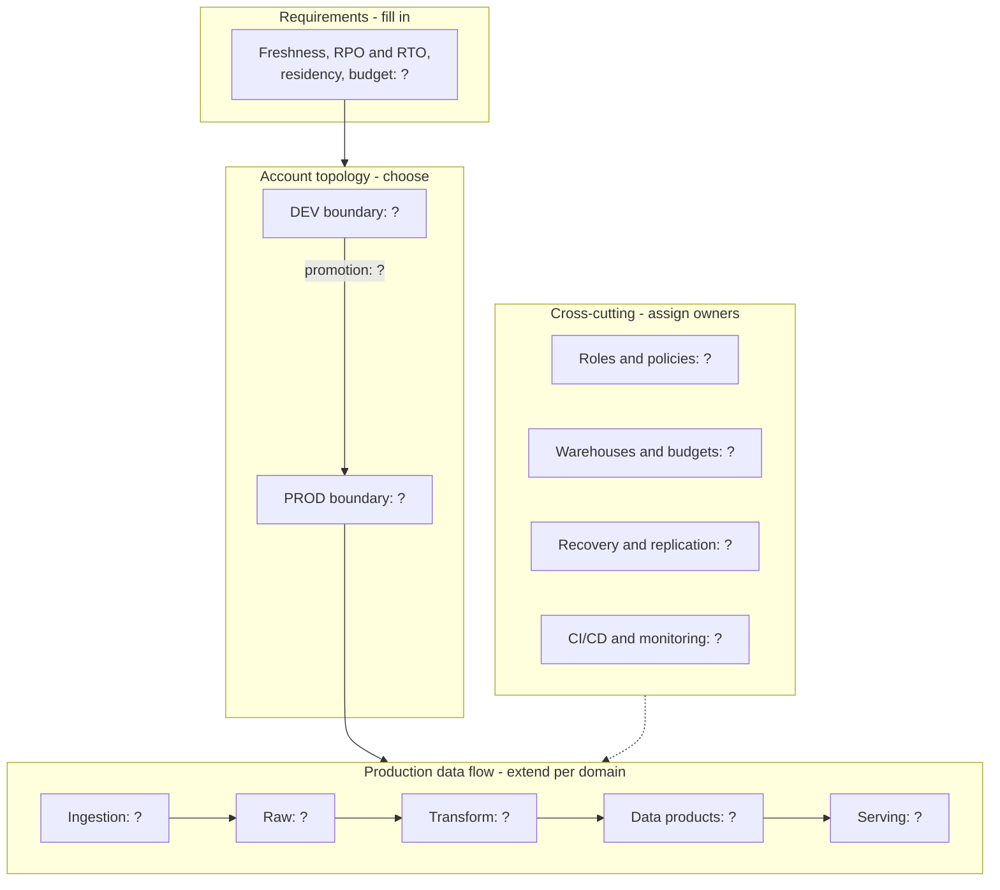
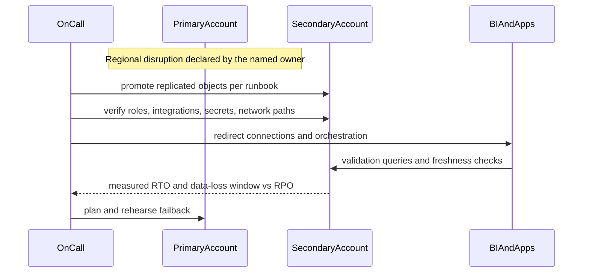

# Architecture Brief: Production Snowflake Platform

## Starting Topology

Treat the following as a hypothesis to test, not a prescribed answer:

```text
Sources -> Kafka / object storage -> ingestion -> Snowflake raw
        -> dbt or Snowflake-native transformations -> curated data products
        -> BI and governed sharing

Dev and production boundaries -> controlled CI/CD promotion
Airflow or equivalent -> cross-system orchestration where required
```

Figure of the starting hypothesis above (explanatory, not a recommended answer):



**Starting skeleton, not a solution.** Copy it into your own design and replace every question mark with a decision and a reason. Add, split, or remove boxes as your requirements demand.



## Architecture Decisions

### Environment and domain boundaries

Compare one-account logical separation, separate environment accounts, and a hybrid. Evaluate blast radius, regulation, administrator separation, deployment burden, and cross-domain sharing.

### Workload and cost model

Classify ingestion, transformation, BI, and ad hoc usage. Select shared or isolated warehouses based on expected contention and ownership. Define auto-suspend, attribution, budget alerts, and a review owner.

### Data contracts and transformations

Define raw retention and replay, curated grain and schema contracts, data-quality tests, freshness, and responsibility for late corrections. Choose between Snowflake tasks, dynamic tables, dbt, and external orchestration according to control and workflow boundaries.

### Security and governance

Define human and service roles, least privilege, future grants, policy ownership, sensitive-data handling, external integrations, and audit evidence. Test permitted and denied consumer paths.

### Recovery and continuity

State RPO/RTO, eligible recovery mechanisms, replication requirements, application cutover, identity/integration readiness, validation, and failback. A database replica alone is not the whole recovery plan.

Example shape of a timed recovery drill (generic; your mechanisms and steps will differ):



Every arrow after the first is outside "data replication"; that is why a replica alone does not meet an RTO.

### Delivery and operations

Define source control, deployment identity, CI validation, environment promotion, monitoring, alert ownership, runbooks, incident process, and cost review.

## Required Trade-Off Record

For every major decision, record:

- requirement and constraints
- selected option and alternatives considered
- benefits and costs across security, cost, latency, correctness, and operations
- assumptions and evidence still needed
- failure mode and owner
- signal that would trigger a future redesign

## Review Questions

- What is deliberately not being built in the first release?
- Which component owns retries, orchestration, data quality, and alert state?
- Can the design be operated by the team that exists today?
- Where is data copied, and who owns every copy's access and retention?
- How is recovery proven against the actual objective?
- What usage evidence would justify a new account, warehouse, or service?