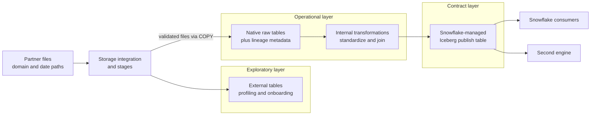
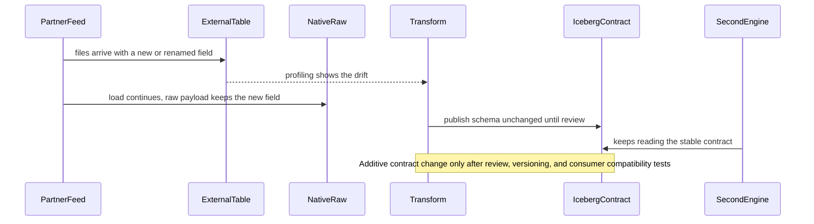

# Architecture - 04 Snowflake Open Table Publish

## Components

- partner files in object storage
- Snowflake storage integration and stages
- external table exposure layer
- native raw ingestion layer
- curated publish layer as Snowflake-managed Iceberg
- consumer contract validation

## Target Project Shape

The intended implementation should include:

- one explicit raw file landscape
- one exploratory access path through external tables
- one native raw ingestion table boundary
- one curated publish table that acts as an open-format contract
- one decision note explaining why each boundary exists

## Data Flow

1. partner files land in stable domain/date paths
2. external tables expose raw files for profiling and onboarding
3. validated files load into native raw tables with lineage metadata
4. internal transformations standardize and join the data
5. curated output is published as a Snowflake-managed Iceberg table
6. downstream engines consume the published contract, not the raw file layer

Figure of the data flow above (explanatory skeleton; object names are yours to choose):

The only arrows that leave the platform start at the contract layer; external tables help onboarding but never become the consumer interface.

## Modeling Rules

- the exploratory layer should remain close to files
- the operational layer should preserve truth and replayability
- the contract layer should be smaller, cleaner, and slower-changing than internal transformation layers

## Trade-Offs

- external tables are faster for onboarding, weaker for long-term serving
- native tables are stronger for transformation operations inside Snowflake
- Snowflake-managed Iceberg is strongest when a curated dataset must cross an engine boundary

Example failure path to adapt: upstream schema drift absorbed before it reaches the contract.

## What Would Change In Production

- stricter contract versioning
- more formal schema-change review at the publish layer
- storage-lifecycle governance for Iceberg data
- consumer onboarding and compatibility testing across engines