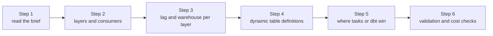
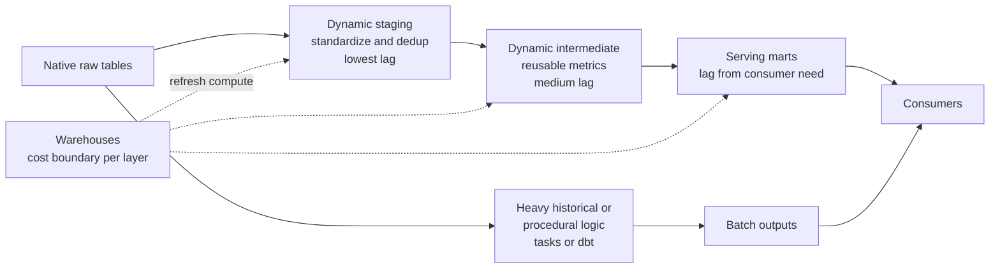
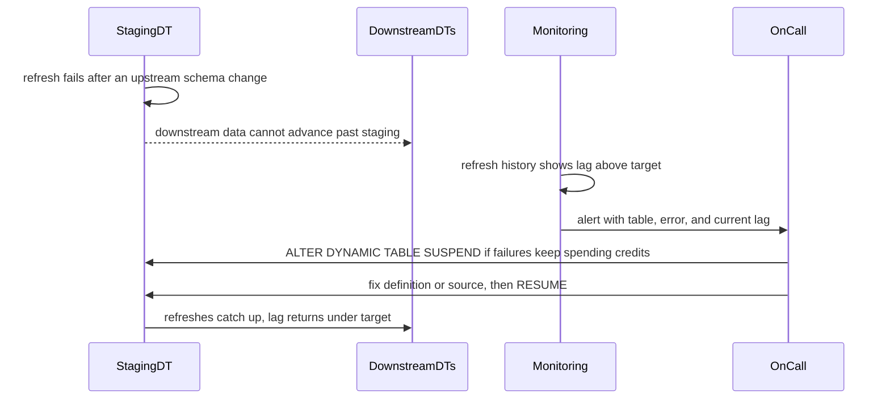

# Architecture - 05 Snowflake Dynamic Table Pipeline

## Components

- native raw Snowflake ingestion tables
- dynamic staging layer
- dynamic intermediate layer
- serving mart layer
- warehouse and cost boundaries
- validation and operational controls

## Target Project Shape

The intended implementation should include:

- one clear source model
- one freshness classification by layer
- dynamic table definitions for the layers where declarative refresh is justified
- one explanation of when tasks or dbt should take over

Project milestones (from the README plan):

## Data Flow

1. raw operational data lands in native tables
2. dynamic staging tables standardize and deduplicate near-ingestion data
3. dynamic intermediate tables compute reusable metrics
4. serving marts expose freshness-appropriate outputs
5. heavy historical or procedural logic stays outside the low-lag dynamic path

Example skeleton to adapt (the brief's flow; lag values are yours to set):

## Modeling Rules

- low-lag layers should be narrow and operationally meaningful
- heavy transformations should not pretend to be real-time without a real consumer need
- target lag is part of the contract, not a decorative setting

## Trade-Offs

- dynamic tables reduce orchestration work for simple table pipelines
- lower lag increases compute pressure and operational sensitivity
- selective usage is stronger than making every transformation always-on

## What Would Change In Production

- stronger monitoring of actual lag and refresh failures
- warehouse auto-scaling and cost guardrails
- deeper CI and test integration around transformation changes
- explicit incident playbooks for suspending or resuming dynamic refresh

Example incident path to adapt into a playbook:

