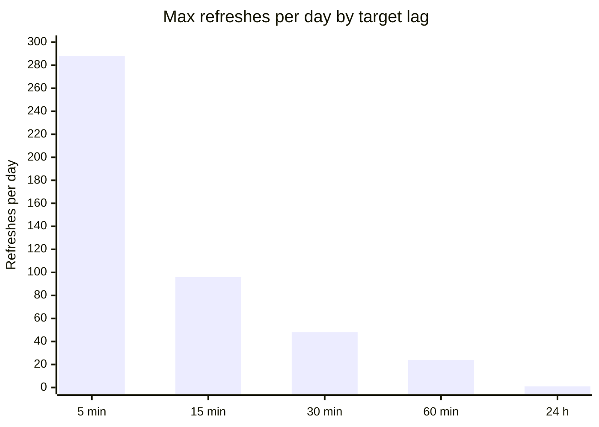
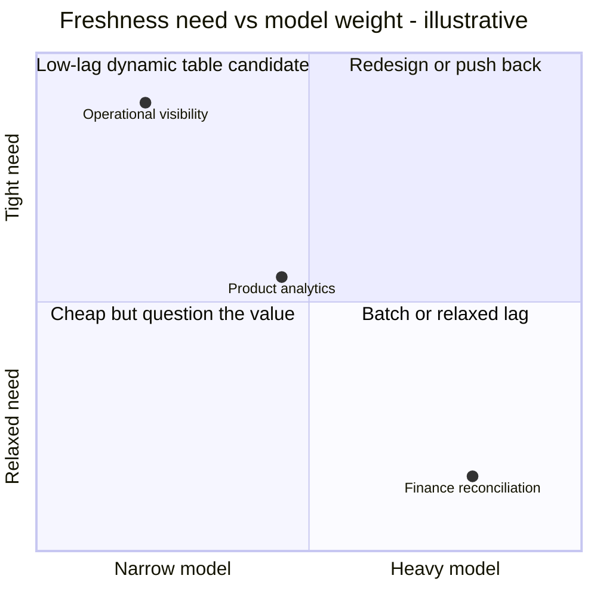

# Freshness SLA Notes

Use this file to propose different latency classes.

Suggested classes:

- operational visibility: 5 minutes
- product analytics: 15 to 30 minutes
- finance reconciliation: hourly or daily

Why lag is a cost decision: the upper bound on scheduled refreshes per day grows quickly as lag shrinks (illustrative arithmetic; real cost depends on changed data, refresh mode, and warehouse size).

Questions to answer:

- which stakeholders actually need freshness, and which only say they do?
- which models are narrow enough to justify low lag?
- which models are too heavy for low-lag dynamic maintenance?

Rule:

- every lag choice should map to a consumer need and a cost trade-off.

A thinking aid for the questions above. The placements are illustrative only; move them based on your own consumers and model sizes.

