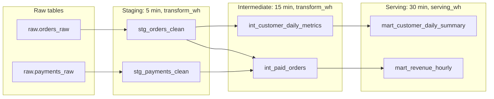

# Reference Example - Snowflake Dynamic Table Pipeline

This folder contains a ready comparison example for the guided Snowflake dynamic-table pipeline project.

Its purpose is:

- self-checking after attempting the guided project
- showing one credible lag-tiered refresh design using dynamic tables selectively
- preserving a concrete example of how freshness, cost, and layer boundaries fit together

You should attempt the guided project first:

- `16-cloud-databases/01-snowflake/pet-projects/05_snowflake_dynamic_table_pipeline`

Only after that should you compare your implementation with this reference example.

## What This Reference Example Demonstrates

- a narrow low-lag staging layer
- an intermediate metrics layer with slower refresh
- a serving mart with business-appropriate freshness
- checks that validate lag-tier reasoning and duplicate protection

## Folder Overview

- `data/freshness_matrix.md` for the latency classes and why they differ
- `src/01_staging_dynamic_tables.sql` for the clean staging layer
- `src/02_intermediate_dynamic_tables.sql` for reusable metrics tables
- `src/03_serving_dynamic_tables.sql` for the serving mart layer
- `tests/refresh_and_quality_checks.sql` for reconciliation and design checks

Lineage and lag tiers as defined in `src/`:

Lag widens downstream and never tightens. Target lag is measured against the base tables, so the 30-minute marts promise about 30 minutes behind raw, not 5 + 15 + 30. Serving refreshes run on a separate warehouse so their cost and contention stay visible.

## Why This Is A Good Reference Shape

- low-lag refresh is reserved for narrow, high-value layers
- heavy logic is not forced into unrealistic freshness promises
- the SQL makes warehouse ownership and lag choices visible
- validation covers both correctness and architecture intent