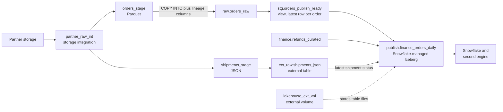

# Reference Example - Snowflake Open Table Publish

This folder contains a ready comparison example for the guided Snowflake open-table publishing project.

Its purpose is:

- self-checking after attempting the guided project
- showing one credible boundary between external tables, native raw tables, and Snowflake-managed Iceberg
- preserving a concrete example of publish-contract thinking instead of feature collection thinking

You should attempt the guided project first:

- `16-cloud-databases/01-snowflake/pet-projects/04_snowflake_open_table_publish`

Only after that should you compare your implementation with this reference example.

## What This Reference Example Demonstrates

- a raw file exposure layer through external tables
- a native raw ingestion contract with lineage columns
- a curated Iceberg publish contract for cross-engine consumption
- validation checks that protect layer boundaries and publish stability

## Folder Overview

- `data/assumptions.md` for feed, contract, and ownership assumptions
- `src/01_external_exposure.sql` for stage, file format, and external table definitions
- `src/02_native_raw_ingestion.sql` for raw-table DDL and `COPY INTO` patterns
- `src/03_publish_contract.sql` for the curated Iceberg publish table and load logic
- `tests/publish_boundary_checks.sql` for contract and boundary validation queries

Lineage as defined in `src/`:

Note the trade-off in this reference: shipment status is read from the external table during publish. That is acceptable while shipments stay exploratory, but a production version would usually load shipments natively first so the publish job does not depend on file-registration freshness.

## Why This Is A Good Reference Shape

- raw access, warehouse operations, and consumer contract are separated explicitly
- Iceberg is used because the dataset truly crosses an engine boundary
- the publish schema is narrower and more stable than internal transformation layers
- validation protects architecture intent, not only SQL syntax