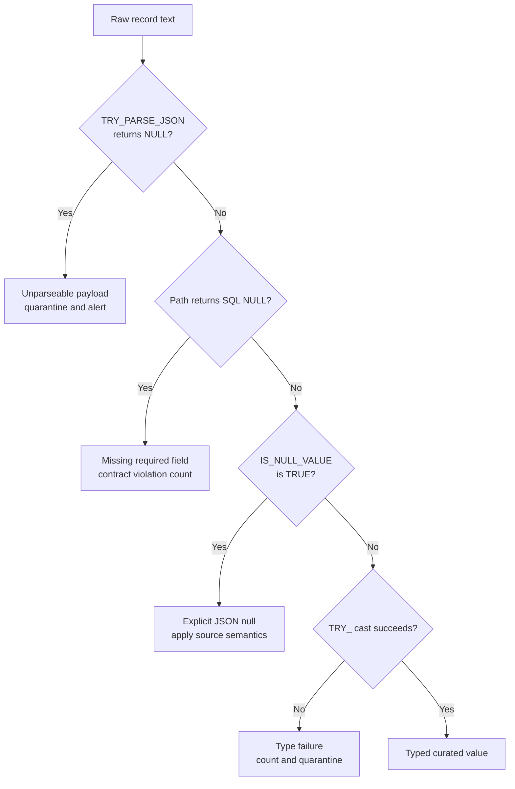

# Solution: Task Set 02

## Task 1

Preserve the represented instant and its source offset or timezone interpretation. Agree whether downstream values are normalized to UTC, which timezone is used for display, and how daylight-saving transitions are handled. Choose a timestamp type only after defining that contract; do not infer UTC from a timezone-free value.

## Task 2

```sql
SELECT
  payload:order.id::STRING AS order_id,
  TRY_TO_NUMBER(payload:order.total::STRING, 10, 2) AS order_total
FROM raw_orders;
```

Track cast failures rather than silently accepting nulls for required business fields.

## Task 3

```sql
SELECT
  payload:order.id::STRING AS order_id,
  item.index AS item_index,
  item.value:sku::STRING AS sku,
  TRY_TO_NUMBER(item.value:quantity::STRING) AS quantity
FROM raw_orders,
LATERAL FLATTEN(INPUT => payload:items) AS item;
```

The grain changes from one row per order payload to one row per item. Order-level measures must not be summed after flattening without accounting for duplication.

## Task 4

Keep raw source text or an equivalent ingestion record so parse failures can be diagnosed. Use safe parsing and explicit required-field checks; measure missing paths and JSON nulls separately where business meaning differs. Quarantine or alert on invalid records according to the source contract.



## Task 5

Keep the original payload in a governed raw layer for replay and evolving fields. Promote frequently used keys and measures into typed curated columns with declared semantics, tests, and ownership. This hybrid preserves source evidence without forcing every consumer to repeat unvalidated path extraction.