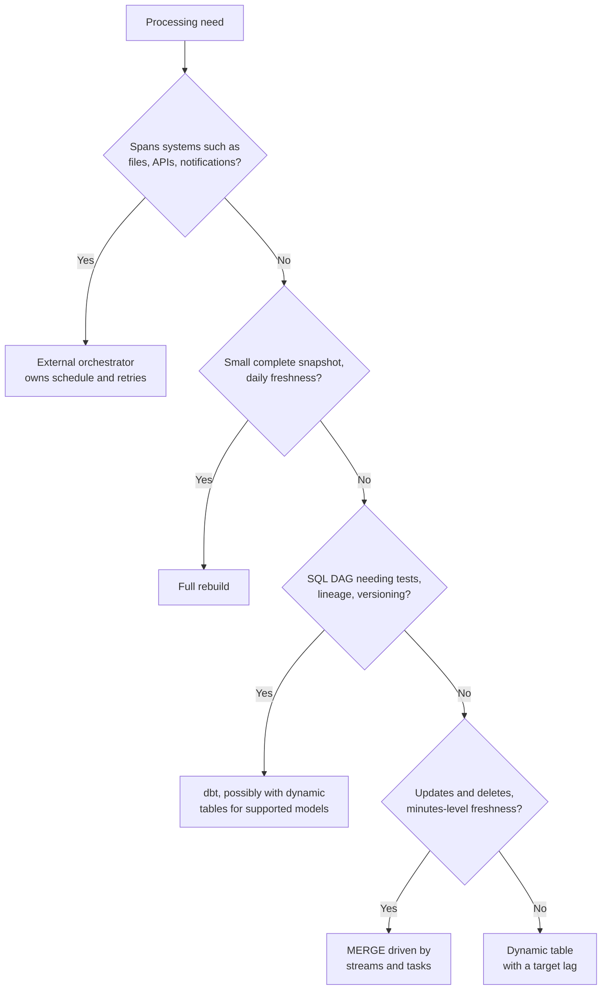

# Solution: Task Set 04

One possible decision path across the five tasks; real constraints can override any branch:

## Task 1

A full rebuild is likely simplest and easiest to reason about at this size and freshness target. Confirm the snapshot is complete and rebuild cost remains acceptable.

## Task 2

Use a stable key and explicit delete/correction semantics. `MERGE` with streams and tasks may fit a Snowflake-native incremental pipeline; dbt or external orchestration may be preferable when tests, deployment, or broader workflow ownership are central. Test retries and late changes.

## Task 3

An external orchestrator is a strong candidate because the workflow spans systems and needs centralized retries and run state. Snowflake tasks may still perform an internal SQL subgraph, but only one system should own the end-to-end schedule and incident state.

## Task 4

dbt is a strong candidate for versioned SQL models, tests, lineage, and documentation. Dynamic tables may fit some supported transformations when the freshness objective and managed refresh model are appropriate. Compare supported queries and desired operational control.

## Task 5

A transaction that commits consumption of a stream advances its change position. If the target write and stream consumption are not atomic as intended, a retry can skip or repeat work. Test failure before write, during write, after commit, and during downstream retry; verify final target state and stream position.