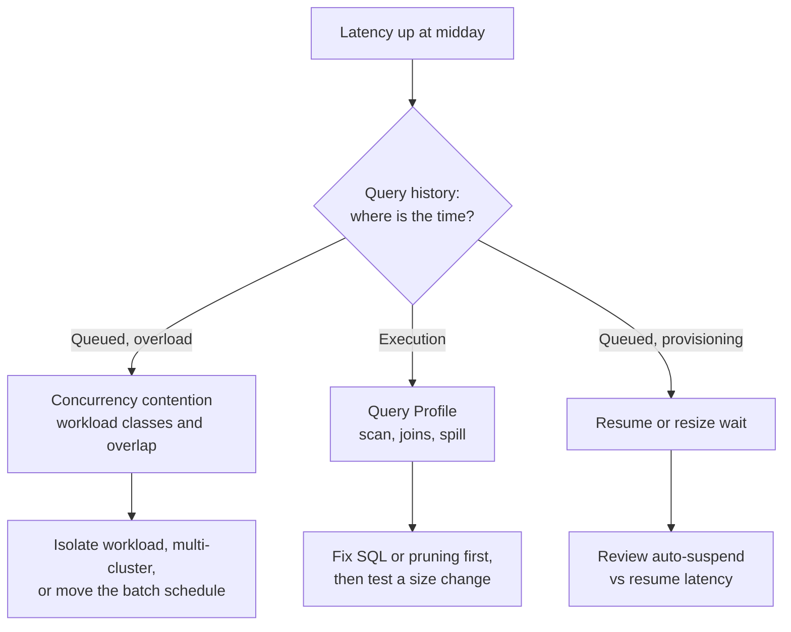

# Solution: Task Set 05

## Task 1

Inspect warehouse concurrency, queued workload classes, and scheduling overlap. A workload-specific warehouse, scaling policy, or schedule adjustment may help if it addresses demonstrated contention. Resizing one warehouse will not necessarily fix unrelated queueing.

In this task the time is in the queue, so the left branch applies; a bigger warehouse targets the middle branch.

## Task 2

Inspect actual filter predicates, partitions scanned, overlap, data distribution, query profile, table size and growth, and workload frequency. First verify semantics and unnecessary scans. Cluster only if repeated workload evidence justifies maintenance cost.

## Task 3

Measure correctness, elapsed time, cost/credits, cache state, repeatability, concurrent workload impact, and representative data volume. Set thresholds and rollback conditions.

## Task 4

The second run may benefit from result reuse or local cache. Compare cold and warm behavior, representative concurrency, changed-data behavior, and usage. Report the test conditions.

## Task 5

Define a budget owner, attribution tags or naming, warning and action thresholds, alert destination, response/runbook, forecast review, and escalation. A monitor without an accountable responder is not an operating control.