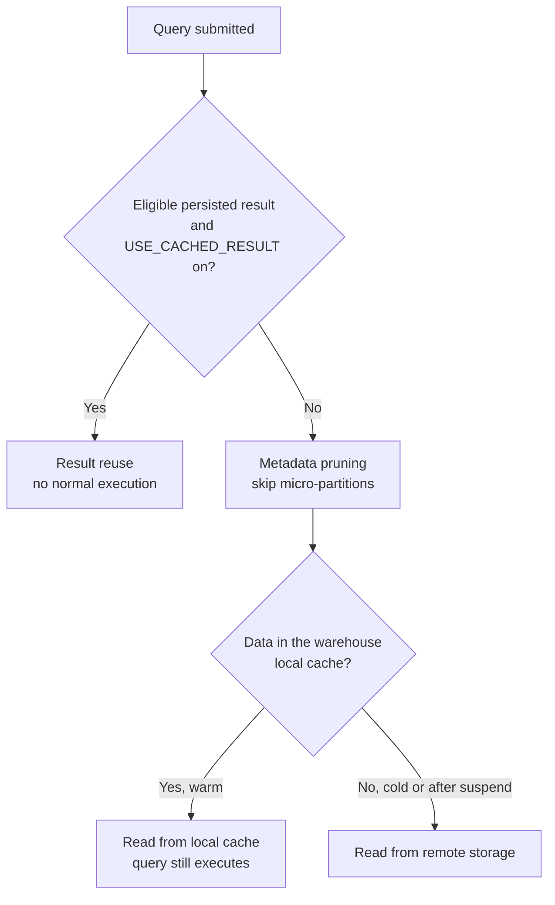

# Solution: Task Set 10

These are example answers, not the only valid designs. State assumptions and use representative Query Profile/History evidence before making a production change.

## Task 1: Decompose End-to-End Latency

Provisioning is the dominant measured wait at 66 seconds; execution is 21 seconds and compilation is 2 seconds. The 95-second end-to-end time may include other phases, so do not assume the listed components are a complete additive decomposition without checking their definitions.

Check whether the warehouse was suspended or resized before the report; compare repeated runs while active; and establish whether resume latency is acceptable for the BI SLA. An auto-resume warehouse may be cheaper when idle, while a longer active window may reduce resume latency and preserve local cache at additional idle cost. A larger warehouse does not directly fix provisioning wait.

## Task 2: Interpret Spill

The high remote spill and Join output growth point first to intermediate row volume/cardinality, not automatically to an undersized warehouse.

1. Inspect the Join input and output rows, keys, uniqueness, and intended grain.
2. Check whether filters/projections can reduce input before the join while preserving results.
3. Check skew, sort/aggregate work, and spill on downstream operators.
4. Test a corrected/deduplicated or pre-aggregated input where the data contract permits.
5. Re-run at the same data/warehouse/concurrency, then test a larger warehouse only if the remaining operator is memory/compute constrained.

A larger warehouse can reduce spill for eligible work but may increase credits without fixing a many-to-many logic error.

## Task 3: Broad Scan Or Expected Scan?

A useful equivalence test for an NTZ timestamp with the stated date semantics is:

```sql
WHERE order_ts >= '2026-01-15 00:00:00'::TIMESTAMP_NTZ
  AND order_ts <  '2026-01-16 00:00:00'::TIMESTAMP_NTZ
```

Compare result rows around midnight/timezone boundaries, partitions and bytes scanned, selected columns, and underlying load distribution. A date predicate returning 0.3% of rows while scanning 92% of partitions suggests weak locality/pruning for this workload, but the ratio is not automatically “bad” for other queries: a broad aggregate may need most data, and partition overlap/data distribution matter.

If the equivalent range still scans most partitions, investigate natural clustering, physical distribution, and workload frequency before testing clustering or another feature. Do not add a cluster key solely from this one query.

## Task 4: Join Fan-Out

Possible causes include duplicate keys on both sides, an incomplete join condition, a genuine one-to-many relationship, inconsistent key normalization, or a many-to-many relationship that the report did not intend.

Check key multiplicity on each side and define the expected grain. Verify a sample of high-multiplicity keys, unmatched rows, and null behavior. If the dimension should be one row per customer, enforce a deterministic survivorship rule or fix upstream uniqueness; if the relationship is truly one-to-many, aggregate at the intended grain before summing order-level metrics. Compare output row counts and control totals after the change. Never apply `DISTINCT` merely to make the row count look smaller.

## Task 5: Cache-Aware Benchmark

- **Persisted result reuse** may return an eligible previous result without executing the normal query plan. `USE_CACHED_RESULT = FALSE` disables this result-reuse path for the test session/query context.
- **Warehouse local data cache** reuses data on active warehouse compute while the query still executes; suspending a warehouse clears the local cache.
- **Metadata/pruning** uses metadata to skip data and is neither of those caches.



A small matrix:

1. Run normally and record whether a prior result was reused.
2. Set `USE_CACHED_RESULT = FALSE`, then run on an active warehouse to measure execution with possible warm local data cache.
3. After a controlled suspend/resume, run again with result reuse disabled to observe cold local-data behavior.
4. Compare query ID, execution/queue time, cache percentage, bytes scanned, partitions, result correctness, and warehouse usage.

Do not repeatedly suspend a shared production warehouse only to create cold benchmarks; use an isolated test warehouse and document resume latency.

## Task 6: Choose The Serving Table Pattern

Phase 1: use an external table for quick file discovery and schema/quality profiling, with monitored metadata refresh. Phase 2: once validated, load into native Snowflake raw/curated tables for repeat BI joins, freshness/completeness checks, and operational serving. Make replay deterministic with source batch/file IDs and business keys.

Do not adopt Iceberg merely because the source is Parquet. Revisit it if Spark becomes a committed consumer of the same stable curated table contract and the teams agree on metadata authority, storage, schema evolution, and maintenance. If another catalog already owns the Iceberg ecosystem, evaluate externally managed Iceberg rather than introducing a second catalog authority.

## Task 7: Select An Optimization Feature

- **Daily date-range report:** it meets SLA, so keep the baseline unless broader workload/cost evidence motivates change. Inspect scan and usage; do not add clustering just because the table is 6 TB.
- **Hourly point lookup by customer ID:** verify that the lookup is selective and supported, inspect scan/pruning, and evaluate Search Optimization against expected lookup volume and maintenance/storage cost. Clustering might be more appropriate for repeated range/locality patterns, not automatically for point lookups.
- **Repeated aggregation with 30-minute freshness:** compare query-time execution with a materialized view, dynamic table, maintained aggregate, or dbt model. Select the least complex option that meets the freshness/ownership requirement; compare refresh spend and failure/lag monitoring as well as read latency.

For all three, compare correctness, p50/p95 latency, bytes/partitions scanned, feature usage/maintenance, and impact on shared warehouse workloads.

## Task 8: Performance Architecture Decision

Treat the two symptoms independently:

- **BI queueing:** schedule the nightly transformation away from peak, isolate BI and batch workloads into owned warehouses if measurements justify the extra resource boundary, or evaluate eligible multi-cluster behavior for concurrent demand. Compare `QUEUED_OVERLOAD_TIME`, queue distribution, warehouse load, and cost.
- **Nightly remote spill:** inspect the operator-level Join/Aggregate/Sort/Window rows, skew, and spill. Reduce fan-out and input width, pre-aggregate if semantics allow, and test warehouse size only after plan work is reviewed.
- **Cache policy:** compare warm repeated BI runs with first-run behavior. A longer active window can keep local cache but trades against idle credits; persisted result reuse is separate.
- **Governance:** assign warehouse/query tags, budget alert ownership, and a review cadence.

Success means the BI SLA improves without uncontrolled cost, the nightly result stays correct, remote spill is reduced or explained, and the change is reproducible under expected concurrency.

## Expected Senior-Level Standard

A complete answer ties the observed metric to a plausible mechanism, identifies at least one alternative, preserves the result contract, includes direct and hidden costs, and names the evidence that would cause the recommendation to change.
