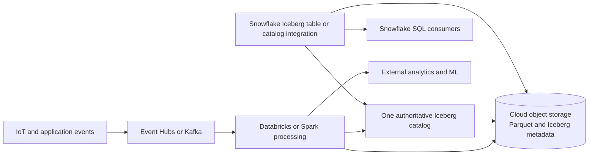

# Iceberg Multi-Engine Data Sharing

Архітектурна нотатка за ProjectPro IoT #6, Snowflake Iceberg/streaming матеріалами та надісланим synthesis. Вона призначена як швидко знайдений design reference для P12 і подальшого навчання, не як затверджена production схема.

## Джерела

- [ProjectPro Snowflake projects, idea #6](https://www.projectpro.io/article/snowflake-projects/1168) — IoT, Event Hubs, Databricks/Spark та Snowflake.
- [Snowflake streaming reference architectures](https://www.snowflake.com/en/blog/modern-data-streaming-pipeline-architectures-industry-use-cases/) — vendor examples; перевірити актуальність окремих feature statements.
- [Snowflake Open Lakehouse](https://www.snowflake.com/en/blog/build-open-data-lakehouse-iceberg-tables/) і [Unifying Iceberg Tables](https://www.snowflake.com/en/blog/unifying-iceberg-tables/) — історичні posts; details змінилися після preview.
- [DuckDB / Snowflake Iceberg example](https://medium.com/datamindedbe/quack-quack-ka-ching-cut-costs-by-querying-snowflake-from-duckdb-f19eff2fdf9d) — корисний для external-reader idea, але одна частина прикладу застаріла (див. [practical examples](../../sources/snowflake/examples.md)).

## Reference flow

Diagram labels are logical placeholders, not a verified service configuration. Storage provider, catalog, credentials, write mode, and Snowflake access route must be selected and validated independently.

## Decision questions

- **Who writes?** Name one authoritative writer for each table by default. Multi-writer is a deliberate capability/coordination choice, not implied by Iceberg.
- **Who owns the catalog?** Compare Snowflake-managed catalog, AWS Glue, Databricks/Unity path, Horizon or another supported REST catalog. Keep a single authoritative metadata commit path.
- **Who owns storage and lifecycle?** Identify access policy, credentials, compaction, snapshot expiry, retention, orphan cleanup and recovery owner.
- **What can Snowflake do?** Define read/write capabilities and freshness per actual catalog integration. Do not generalize from Iceberg format version alone.
- **What does AWS vs Azure change?** Validate storage credentials, catalog integration, region/account availability, network/egress, external engine support and operational procedures. A cloud service mapping table alone is insufficient proof of parity.
- **What is measured?** Freshness from producer commit to consumer visibility, query performance, concurrency, refresh health, credits, storage and data-transfer cost.

## Anti-patterns to challenge

- Reporting directly from mutable raw files without a stable consumer contract.
- Choosing Iceberg to avoid hypothetical lock-in without an actual second-engine consumer.
- Two systems independently acting as metadata authority or writer without tested conflict semantics.
- Calling a pipeline “real-time” without a latency objective and measured end-to-end delay.
- Claiming lower total cost by comparing only Snowflake warehouse credits while ignoring storage, egress, cache, catalog, and operations.

## Пов'язані матеріали

- [P12 E2E handoff](../../../../16-cloud-databases/01-snowflake/end-to-end-projects/HANDOFF.md)
- [P12/P13/P16 catalog](../../../../16-cloud-databases/01-snowflake/end-to-end-projects/README.md)
- [Theory sources](../../sources/snowflake/theory.md), [practical examples](../../sources/snowflake/examples.md), [E2E source list](../../sources/snowflake/e2e-projects.md)
- [Iceberg learning review](../../topics/snowflake-iceberg-production-architecture.md)

## Неперевірені посилання з вихідного synthesis

Нижче — citations, які були надіслані разом із composite architecture summary, але ще не перевірені по суті:

- [Snowflake for data engineers: fundamentals to production architecture](https://medium.com/@manoranjanpandey836/snowflake-for-data-engineers-from-fundamentals-to-production-architecture-part-1-343fab6bcb9b)
- [Snowflake: Building a Data Cloud](https://medium.com/snowflake/snowflake-building-a-data-cloud-8995627ce785)
- [KloudPortal pipeline best practices](https://kloudportal.ai/snowflake-data-pipeline-architecture-best-practices-for-data-engineers/)
- [Streaming video](https://www.youtube.com/watch?v=XwCnOsZMhyI)
- [Softweb Snowflake use cases](https://www.softwebsolutions.com/resources/snowflake-use-cases/)
- [Folio3 Snowflake use cases](https://data.folio3.com/use-cases/snowflake/)
- [FindAnomaly dashboard guide](https://www.findanomaly.ai/building-dashboards-bigquery-snowflake-complete-guide)
- [Snowflake introductory concepts](https://docs.snowflake.com/en/user-guide/intro-key-concepts)