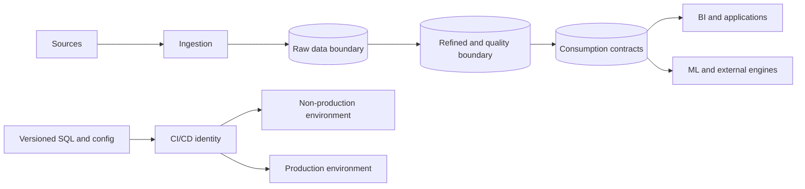

# Production Snowflake Data Platform

Це власна коротка архітектурна нотатка за матеріалами, надісланими 2026-11-11. Це не копія однієї статті і не готова універсальна рекомендація.

## Джерела

- [Designing a Production Ready Snowflake Architecture](https://armely.com/blog/designing-a-production-ready-snowflake-architecture-9910139263) — Martin Muchuki, 2026-09-28. Корисний checklist для ізоляції, workloads, доступу й deployment.
- [How to pitch your boss to adopt Apache Iceberg](https://blog.dataengineerthings.org/how-to-pitch-your-boss-to-adopt-apache-iceberg-6da93c969f67) — вміст не вдалося перевірити: посилання перенаправляє на Medium identity gate.
- [Snowflake customer case studies](https://medium.com/%40masteringsnowflake/learnings-from-real-world-snowflake-customer-case-studies-b2f5f1a8eeb6) та [Snowflake retail analytics pipeline](https://www.snowflake.com/en/developers/guides/building-retail-analytics-de-pipeline/) — наведені у вихідному огляді, але конкретні твердження ще не звірені з першоджерелом.

## Резюме патерну

Розділяй **deployment path** і **data path**. Код і grants просуваються з version control через контрольоване CI/CD; production data рухається через ownership/lifecycle boundaries до стабільного споживчого контракту. Вибір одного account з розділеними database, non-prod + prod accounts чи окремих Dev/Test/Prod accounts залежить від ризику, compliance, blast radius, адміністрування та зрілості автоматизації.

## Design choices to study

- **Environment isolation:** names such as `DEV` and `PROD` do not enforce security by themselves. Compare account/database/role boundaries by required blast radius and operational overhead. The source article presents non-prod + prod as a pragmatic pattern, not a universal industry mandate.
- **Data boundaries:** Raw, Refined, and Consumption are responsibilities. They do not automatically require three separate databases; choose schema/database boundaries based on ownership, grants, sharing, retention, and lifecycle.
- **Compute separation:** isolate workloads when concurrency, latency, or cost attribution requires it. Derive warehouse layout and size from measured workload rather than using a fixed warehouse per label.
- **Identity:** use functional service identities and least-privilege roles for automation; keep high-privilege account administration out of routine deployment.
- **Deployment vs cloning:** cloning supports test-data setup and recovery; it does not replace versioned DDL and repeatable grants promotion.
- **Evidence:** quantify customer impact claims. The supplied text's “nearly 80%” NatWest cost/carbon claim remains unverified and should not be repeated as fact.

## Пов'язані source lists

- [Snowflake theory and reference links](../../sources/snowflake/theory.md)
- [Snowflake E2E and production sources](../../sources/snowflake/e2e-projects.md)
- [Production architecture learning review](../../topics/snowflake-iceberg-production-architecture.md)

## Open questions

- Яка account separation policy потрібна конкретній організації та регуляторному контексту?
- Які workloads реально конфліктують за latency/concurrency і чи доводять це query history?
- Хто owns grants, catalog, deployment identity, data contracts, recovery та incident response?
- Які незалежні джерела підтверджують бізнес-метрики, наведені в customer cases?