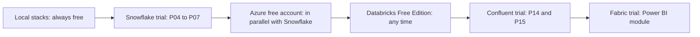

# 4. Free Cloud Accounts and Demo Hosting

Which accounts to open, in what order, how to protect them on day one, and where to show your work. Offers change often: the numbers below are what to look for, and you should confirm the current terms on the sign-up page.

## Summary

Detailed step-by-step guides for each account (sign-up fields, day-one security, configuration, verification, cleanup) are in [accounts/](accounts/README.md). This page is the overview.

| Provider | Free offer to look for | Card | Best for in this repo | First guardrail |
| --- | --- | --- | --- | --- |
| Snowflake | 30-day trial with usage credits | Not required for the trial | `16-cloud-databases`, P01 to P16 | Resource monitor, XS warehouses |
| Microsoft Azure | Free account: starter credit for the first month plus free services; Azure for Students without a card | Required (except Students) | P04, P08, P12, `09-azure-data-lake-storage` | Budget on subscription and resource groups |
| AWS | Free plan with starter credits for new accounts | Required | AWS variants of projects | Zero-spend budget, root MFA |
| Google Cloud | Free trial credits; BigQuery sandbox without a card | Trial: required; sandbox: no | BigQuery comparisons | Budget alert; use the sandbox first |
| Databricks | Free Edition (serverless, quota-limited, personal use); cloud trials | Free Edition: no | `07-databricks`, `08-delta-lake`, P12 | Quotas are built in |
| Confluent Cloud | Starter credits for new sign-ups | Check at sign-up | `05-confluent-kafka`, P14 | Delete clusters after labs |
| Microsoft Fabric | Fabric trial capacity | Work or school account needed | `10-powerbi-fabric` | Trial ends by itself |
| dbt Cloud | Developer plan, one seat | No | `12-dbt` | - |
| MongoDB Atlas | M0 shared cluster, free permanently | No | `02-sql` NoSQL practice | - |
| Neon or Supabase | Free Postgres tier | No | Hosted Postgres for demos | - |
| GitHub | Free repos, Actions minutes, Codespaces hours | No | Everything | Watch Codespaces usage |

## Plan Your Trials

Time-limited trials start when you sign up. Open each one when you are ready to use it, not all at once.

Before a trial ends: export your measurements, take screenshots, record a demo video, and run the teardown scripts.

---

## Snowflake

Detailed guide: [accounts/snowflake.md](accounts/snowflake.md).

1. Sign up for the free trial. Choose:
   - **Edition:** Enterprise covers everything in this repository; Standard is enough for P04.
   - **Cloud and region:** Azure and the region you will use for storage (see [Azure and AWS mapping](../../../16-cloud-databases/01-snowflake/end-to-end-projects/_shared/azure_aws_mapping.md)).
2. Activate the account from the email, set your password, and **enroll in MFA** when prompted.
3. Note the account identifier (`<orgname>-<account_name>`) from the account menu.
4. Set up key-pair access for the CLI: [Snowflake CLI](02_cli_tools_and_auth.md#snowflake-cli).
5. Create the project resource monitor and XS warehouses before any lab ([cost guardrails](../../../16-cloud-databases/01-snowflake/end-to-end-projects/_shared/cost_guardrails.md)).
6. In Snowsight, Admin, Cost management: check remaining trial credits every few days.

When the trial ends the account is suspended unless you add a payment method. Export anything you want to keep before that date.

## Microsoft Azure

Detailed guide: [accounts/azure.md](accounts/azure.md).

1. Sign up for an Azure free account (or Azure for Students with a school email).
2. In the portal, Cost Management, **Budgets**: create a monthly budget on the subscription with alerts at 50, 80, and 100 percent.
3. `az login`, then create one resource group per project (`rg-p04-wiki`). Everything for a project goes into it.
4. After the project: `az group delete --name <rg> --yes`.

Starter credits expire after the first month; most paid services then stop unless you upgrade to pay-as-you-go. Storage accounts, Event Grid, and queues for P04 cost very little, but they are not zero.

## AWS

Detailed guide: [accounts/aws.md](accounts/aws.md).

1. Create an account; choose the free plan if offered.
2. Immediately: enable MFA on the root user, then stop using root.
3. Enable IAM Identity Center, create an admin user for yourself, and log in with `aws configure sso` ([AWS CLI](02_cli_tools_and_auth.md#aws-cli)).
4. AWS Budgets: create a **zero-spend budget** (template) and a small monthly budget.
5. Pick one region (the one your Snowflake account would use) and stay in it.

## Google Cloud and BigQuery Sandbox

Detailed guide: [accounts/google_cloud.md](accounts/google_cloud.md).

- **BigQuery sandbox:** open the BigQuery console with a Google account, no billing required. Expect limits on storage, monthly query volume, and table expiration.
- **Free trial:** credits for new customers, card required; set a budget alert in Billing right away.

## Databricks

Detailed guide: [accounts/databricks.md](accounts/databricks.md).

1. Sign up for **Databricks Free Edition** (no card). You get a serverless workspace with quotas, for personal learning.
2. Log in with the CLI: [Databricks CLI](02_cli_tools_and_auth.md#databricks-cli).
3. For features beyond Free Edition (own cloud storage, full Unity Catalog setup, custom clusters), use a time-limited trial on Azure or AWS and delete the workspace and its managed resource group afterwards.

## Confluent Cloud

Detailed guide: [accounts/confluent_cloud.md](accounts/confluent_cloud.md).

1. Sign up; new accounts usually receive starter credits for a limited period.
2. Create a **Basic** cluster in the same cloud and region as your Snowflake account.
3. Use API keys scoped to one cluster, stored only in an ignored env file.
4. Delete the cluster at the end of each lab block: clusters bill per hour even when idle.

Local Kafka ([Stack B](03_local_services.md#stack-b-kafka)) covers most of the learning; use Confluent Cloud for managed connectors and the Snowflake connector in a hosted setting.

## Microsoft Fabric and Power BI

Detailed guide: [accounts/microsoft_fabric_power_bi.md](accounts/microsoft_fabric_power_bi.md).

- **Power BI Desktop** is free and Windows-only. On a Mac, use a Windows virtual machine (for example UTM with Windows on ARM) or a small Windows VM in Azure paid from credits; shut it down after use.
- **Fabric trial:** requires a work or school Microsoft Entra account; personal email domains are typically not accepted. The trial provides capacity for a limited period.
- Without a work or school account, use Power BI Desktop locally and focus on modeling and DAX; publish only to your own workspace.

## Other Free Services

Detailed setups: [accounts/other_free_services.md](accounts/other_free_services.md).

| Service | Free tier | Use |
| --- | --- | --- |
| dbt Cloud Developer | One developer seat | IDE, scheduler, docs hosting for `12-dbt` |
| MongoDB Atlas M0 | Small shared cluster | Hosted MongoDB practice |
| Neon, Supabase | Small hosted Postgres | Backend for public demos |
| Astronomer | Time-limited trial | Managed Airflow comparison |
| GitHub Codespaces | Monthly free core-hours for personal accounts | Cloud dev environment when away from your Mac |

---

## Where to Host a Demo

Trials expire; a demo should outlive them. Choose by audience.

| Option | Cost | Shows | Good for | Watch out for |
| --- | --- | --- | --- | --- |
| Recorded video or GIF in the project README | Free | Everything, permanently | Portfolio, interviews | Record before the trial ends |
| GitHub Pages with MkDocs Material | Free | Docs, diagrams, measured results, static charts | Public portfolio site for this repository | Static only |
| Streamlit in Snowflake | Snowflake credits | Live app on Snowflake data | Demos to people with access to your account | Not public; warehouse cost while open |
| Streamlit Community Cloud | Free | Live public app from a GitHub repo | Public demo on a small hosted database or exported data | Do not point it at a paid warehouse that auto-resumes |
| Hugging Face Spaces | Free CPU tier | Streamlit or Gradio app | Public demo on static or small data | Public by default |
| Looker Studio on BigQuery sandbox | Free | Live dashboard | Public BI demo | Sandbox limits |
| Raspberry Pi with Cloudflare Tunnel or Tailscale | Hardware only | Homelab services from outside your network | `15-raspberry-pi-homelab` | Expose read-only UIs; keep authentication on |

Recommended default for every end-to-end project:

1. Screenshots of the dashboard and the key evidence queries in `assets/`.
2. A short screen recording linked from the project README.
3. The measured numbers in `PROGRESS.md`.
4. Optionally, a static portfolio page built from the repository with GitHub Pages.

Never put credentials into a public demo. If a hosted app must read a database, give it a dedicated read-only user with access to one schema, and a hard spending cap.
