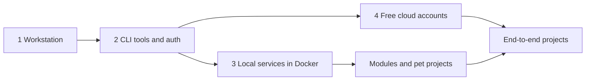

# Setup Guide: Tools, Local Services, and Free Cloud Accounts

One place to prepare everything needed for the modules, pet projects, and end-to-end projects in this repository: what to install, how to configure it, which free accounts to open, and where to host demos.

## How to Use This Guide

Do not install everything on day one. Install the **minimum kit**, then add tools when a module or project needs them. Each section says which modules use it.

| Step | Guide | Result |
| --- | --- | --- |
| 1 | [Workstation (macOS)](01_workstation_macos.md) | Homebrew, Git, VS Code, Python, Java, Docker, utilities |
| 2 | [CLI tools and authentication](02_cli_tools_and_auth.md) | `az`, `aws`, `gcloud`, `snow`, `databricks`, `confluent`, `dbt`, logins without stored passwords |
| 3 | [Local services](03_local_services.md) | Postgres, MySQL, MongoDB, Kafka, Azurite, Spark, Airflow, Flink, Iceberg, Trino on your machine |
| 4 | [Free cloud accounts and demo hosting](04_free_cloud_accounts.md) | Trials and free tiers, guardrails, cleanup, where to publish a demo |
| 4a | [Account guides](accounts/README.md) | Step by step per provider: sign-up fields, day-one security, configuration, verification, cleanup |

## Minimum Kits

| Goal | Install | Accounts |
| --- | --- | --- |
| Modules 00 to 03 (Git, shell, Python, SQL, Docker) | Workstation, Docker, local databases stack | GitHub |
| Snowflake module and P04 | Workstation, `az`, Snowflake CLI, Graphviz (diagrams) | Snowflake trial on Azure, Azure free account |
| Kafka modules, P14, P15 | Workstation, Docker, local Kafka stack, `kcat` | Optional: Confluent Cloud trial |
| Spark, Delta, Databricks | Java 17, PySpark in a venv, Databricks CLI | Databricks Free Edition |
| Airflow, dbt | Docker (Airflow), dbt in a venv | Optional: dbt Cloud Developer |
| Flink, Iceberg | Java 17, Docker, Flink, Iceberg quickstart | None |
| Power BI and Fabric | Windows VM for Power BI Desktop | Fabric trial (work or school account) |

## Tool Map by Module

| Module | Local option | Free cloud option | Section |
| --- | --- | --- | --- |
| `00-git`, `00-shell-linux` | Git, zsh, Homebrew | GitHub | [01](01_workstation_macos.md) |
| `01-python` | Python 3.12, venv or uv | GitHub Codespaces | [01](01_workstation_macos.md#5-python) |
| `02-sql` | Postgres, MySQL, MongoDB in Docker | Neon, MongoDB Atlas M0, BigQuery sandbox | [03](03_local_services.md#stack-a-databases) |
| `03-docker` | Docker Desktop or Colima | - | [01](01_workstation_macos.md#7-docker) |
| `04-github-actions` | `gh` CLI, `act` (optional) | GitHub Actions | [02](02_cli_tools_and_auth.md#github-cli) |
| `05-confluent-kafka` | Kafka in Docker, `kcat` | Confluent Cloud trial | [03](03_local_services.md#stack-b-kafka) |
| `06-spark-pyspark` | PySpark local mode | Databricks Free Edition | [03](03_local_services.md#spark-and-delta-lake) |
| `07-databricks`, `08-delta-lake` | `delta-spark` locally | Databricks Free Edition | [04](04_free_cloud_accounts.md#databricks) |
| `09-azure-data-lake-storage` | Azurite emulator | Azure free account | [03](03_local_services.md#stack-c-azurite-azure-storage-emulator) |
| `10-powerbi-fabric` | Power BI Desktop (Windows) | Fabric trial | [04](04_free_cloud_accounts.md#microsoft-fabric-and-power-bi) |
| `11-airflow` | Official Docker Compose or `airflow standalone` | Astronomer trial | [03](03_local_services.md#airflow) |
| `12-dbt` | dbt Core in a venv | dbt Cloud Developer | [02](02_cli_tools_and_auth.md#dbt) |
| `13-flink` | Flink local cluster | - | [03](03_local_services.md#flink) |
| `14-iceberg` | Iceberg Spark quickstart, Trino | - | [03](03_local_services.md#iceberg-and-trino) |
| `15-raspberry-pi-homelab` | Raspberry Pi | Cloudflare Tunnel for exposure | [04](04_free_cloud_accounts.md#where-to-host-a-demo) |
| `16-cloud-databases` | Snowflake CLI | Snowflake trial | [02](02_cli_tools_and_auth.md#snowflake-cli) |

## Local or Cloud?

| Prefer local when | Prefer cloud when |
| --- | --- |
| Learning the tool's mechanics | The feature only exists as a managed service (Snowpipe, Unity Catalog, Event Grid) |
| Fast iteration and breaking things often | You need realistic identity, networking, and cost behavior |
| No credit card or limited trial time | You want a demo others can open |

Practice locally first, then spend trial credits on what cannot be reproduced locally.

## Safety Rules Everywhere

- Secrets follow [secrets management](../secrets-management.md) and [local env files workflow](../local-env-files-workflow.md): real values only in ignored files or tool credential stores.
- Every cloud account gets a budget alert in the first session.
- Every lab ends with a pause or teardown step; every project has one.
- Local services bind to `127.0.0.1`, never to all interfaces.

Free tiers, trial amounts, and terms change. Each section states what to check; treat the numbers as a starting point and confirm on the provider's site when you sign up.
