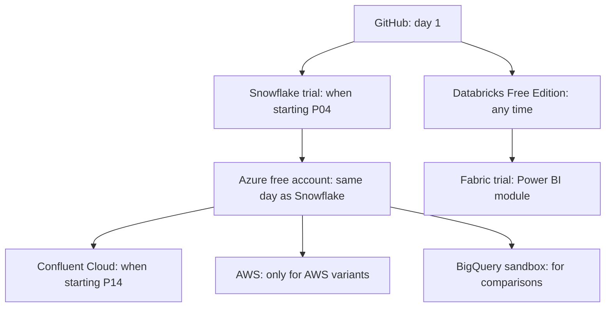

# Cloud and Platform Accounts: Detailed Guides

Step-by-step guides for every free or trial account used in this repository: how to sign up, what to choose in each field, what to secure on day one, how to configure the account for the projects, how to verify it, and how to clean up.

The short comparison and demo hosting options are in [Free cloud accounts and demo hosting](../04_free_cloud_accounts.md).

## Guides

| Account | Guide | Needed for | Card |
| --- | --- | --- | --- |
| Snowflake trial | [snowflake.md](snowflake.md) | `16-cloud-databases`, all end-to-end projects | No |
| Microsoft Azure | [azure.md](azure.md) | P04, P08, P12, `09-azure-data-lake-storage` | Yes (Students: no) |
| AWS | [aws.md](aws.md) | AWS variants of end-to-end projects | Yes |
| Google Cloud and BigQuery sandbox | [google_cloud.md](google_cloud.md) | BigQuery comparisons | Sandbox: no |
| Databricks Free Edition | [databricks.md](databricks.md) | `06`, `07`, `08`, P12 | No |
| Confluent Cloud | [confluent_cloud.md](confluent_cloud.md) | `05-confluent-kafka`, P14, P15 | Check at sign-up |
| Microsoft Fabric and Power BI | [microsoft_fabric_power_bi.md](microsoft_fabric_power_bi.md) | `10-powerbi-fabric` | No (work or school account) |
| GitHub, MongoDB Atlas, Neon, dbt Cloud, Streamlit, Hugging Face | [other_free_services.md](other_free_services.md) | Various modules, demos | No |

## Recommended Order

Open a time-limited trial only when you are ready to use it.

## Day-One Checklist for Every Account

Do these before creating any resource:

- [ ] Strong unique password in a password manager
- [ ] Multi-factor authentication on the sign-in identity
- [ ] Budget or spending alert, or a confirmed hard limit
- [ ] Region chosen and written down (same region across Snowflake, storage, and streaming)
- [ ] A note in your project log: sign-up date, trial end date, credits at start
- [ ] A calendar reminder a few days before the trial ends: export results, record demos, tear down

## Account Register (Fill In, Keep Private)

Copy this table into a private note, not into the repository.

| Account | Sign-up date | Trial ends | Region | Login identity | Budget set | Notes |
| --- | --- | --- | --- | --- | --- | --- |
| Snowflake | | | | | | |
| Azure | | | | | | |
| AWS | | | | | | |
| Google Cloud | | | | | | |
| Databricks | | | | | | |
| Confluent | | | | | | |
| Fabric | | | | | | |

## Accuracy

Sign-up forms, menu names, credit amounts, and trial lengths change. The guides describe what to look for and why; when a screen differs, choose the option that matches the intent described in the step.
